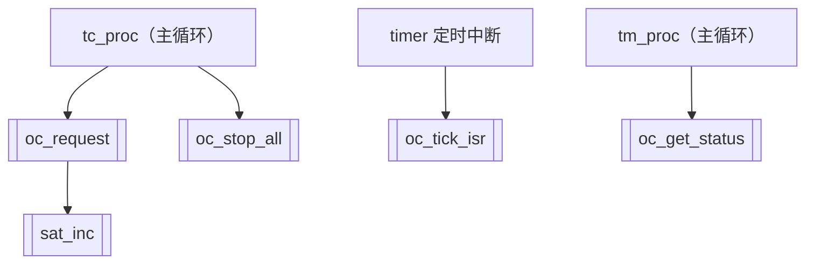
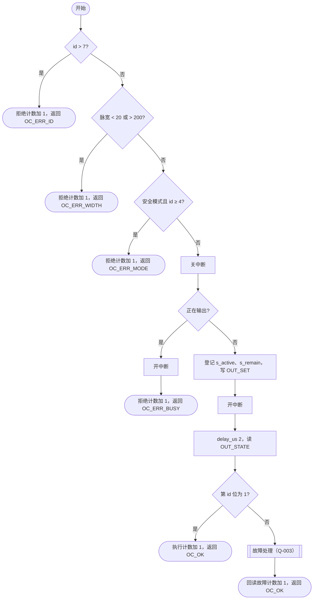
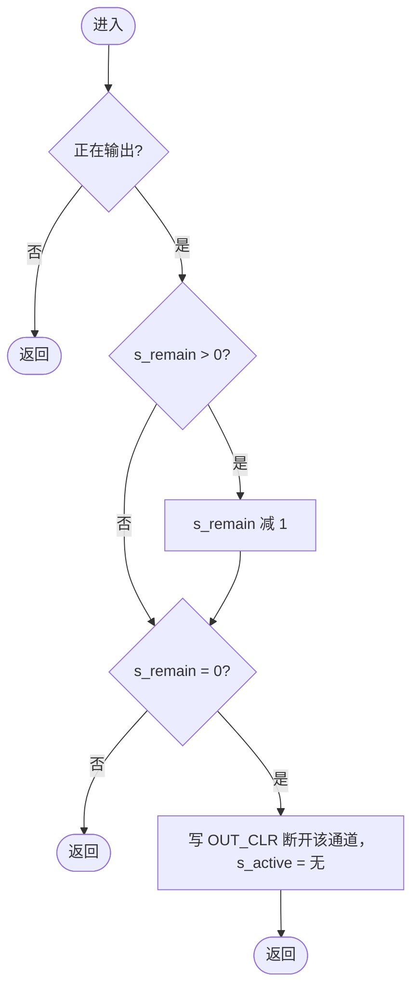

# 载荷配电单元软件 oc_ctrl 软件详细设计说明

## 1 范围

### 1.1 标识

软件名称：载荷配电单元软件；软件简称：PDUS；模块：oc_ctrl（OC 指令输出）；目标平台：BM3803（SPARC V8）；编程语言：C89（PDUS-CON-001）。

### 1.2 模块概述

oc_ctrl 负责 OC 指令的合法性检查、输出、脉宽计时、回读校验和计数（HLD-4.1）。oc_request、oc_stop_all、oc_get_status 在主循环中运行，oc_tick_isr 在 1 ms 定时中断中运行（HLD-3）。

### 1.3 文档概述

正向设计：依据第 2 章的需求规格说明、概要设计说明和控制器接口说明编写。上级文件之间有 4 处不一致或未规定，见第 9 章；相关设计暂按 SRS 编写，并逐处注明。

## 2 引用文档

| 编号 | 名称 | 版本 |
|---|---|---|
| PDUS-SRS-001（SRS） | 载荷配电单元软件需求规格说明 | V1.0 |
| PDUS-HLD-001（HLD） | 载荷配电单元软件概要设计说明 | V1.0 |
| PDU-FPGA-ICD-003（ICD） | OC 输出控制器接口说明 | V1.0 |

## 3 设计依据

### 3.1 需求

| 需求标识 | 原文 |
|---|---|
| PDUS-MOD-002 | 上电或复位后，软件初始化完成前后，所有 OC 输出都应处于断开状态。 |
| PDUS-FUN-021 | 软件应能按遥控指令输出 8 路 OC 指令，指令编号 0～7，分别对应 OC0～OC7。 |
| PDUS-FUN-022 | 每路 OC 指令的输出为高电平脉冲，脉宽由遥控指令参数给定，范围 20～200 ms（含两端）。脉宽超出范围的指令应拒绝执行，并计入指令拒绝计数。 |
| PDUS-PER-005 | OC 指令实际输出脉宽与给定脉宽之差应不大于 ±1 ms。 |
| PDUS-FUN-023 | 同一时刻只允许输出一路 OC 指令。正在输出 OC 指令时收到新的 OC 指令，应拒绝新指令，并计入指令拒绝计数。 |
| PDUS-FUN-024 | OC 指令开始输出后，软件应回读 OC 输出状态；回读结果与期望不一致时，应进行故障处理。 |
| PDUS-FUN-025 | 软件收到“OC 全部断开”指令后，应在 1 ms 内断开全部 OC 输出，并终止正在执行的 OC 指令。 |
| PDUS-SAF-005 | 安全模式下禁止输出载荷类 OC 指令 OC4～OC7，收到时应拒绝并计入指令拒绝计数；OC0～OC3 在两种模式下都允许输出。 |
| PDUS-DAT-007 | 软件应维护以下计数，供遥测下传：OC 指令执行计数、OC 指令拒绝计数、OC 回读故障计数。各计数为 8 位，计到 255 后保持 255。 |
| PDUS-CON-002 | 访问在中断服务程序和主程序之间共享的数据时，应采取关中断等保护措施。 |

### 3.2 概要设计规定

| 条款 | 原文 |
|---|---|
| HLD-3 | oc_request、oc_stop_all 在主循环中运行，oc_tick_isr 在中断中运行，二者共享 OC 输出状态，访问共享数据时须按 PDUS-CON-002 关中断保护。timer 模块的 1 ms 定时中断服务程序每次中断调用一次 oc_tick_isr。 |
| HLD-4.2-1 | `void oc_init(void)`：初始化程序，上电后调用一次；初始化 OC 输出控制器和模块数据。 |
| HLD-4.2-2 | `oc_result_t oc_request(uint8_t id, uint16_t width_ms)`：tc_proc 调用；`id` 为指令编号 1～8，`width_ms` 为脉宽 10～200 ms。 |
| HLD-4.2-3 | `void oc_stop_all(void)`：tc_proc 调用；断开全部 OC 输出。 |
| HLD-4.2-4 | `void oc_tick_isr(void)`：timer 的 1 ms 定时中断调用；脉宽计时，到时后断开输出。 |
| HLD-4.2-5 | `void oc_get_status(oc_status_t *st)`：tm_proc 调用；读取当前状态和各计数。 |
| HLD-4.2-6 | 返回值：OC_OK（已开始输出）、OC_ERR_ID、OC_ERR_WIDTH、OC_ERR_BUSY（正在输出）、OC_ERR_MODE。状态结构：当前输出的指令编号（无输出时为 0xFF）、剩余脉宽（ms）、执行计数、拒绝计数、回读故障计数。 |
| HLD-4.3 | 使用 `mode_get()`（返回 MODE_NORMAL 或 MODE_SAFE）、`irq_lock()`/`irq_unlock()`、`delay_us()`、OC 输出控制器寄存器。 |
| HLD-4.4-1 | 设置深度为 4 的 OC 指令队列：正在输出时收到的指令进入队列，当前指令结束后按先后顺序依次输出；队列满时返回 OC_ERR_BUSY。 |
| HLD-4.4-2 | 脉宽计时由 oc_tick_isr 在 1 ms 定时中断中完成。 |
| HLD-4.4-3 | 寄存器访问通过 oc_reg.h 中的 OC_RD、OC_WR 宏完成。 |

### 3.3 硬件接口

| 条款 | 原文 |
|---|---|
| ICD-1 | 处理器通过 4 个 32 位寄存器访问控制器，基地址 0x80000300。 |
| ICD-2-1 | 0x00 OUT_STATE 只读：位 i（i = 0～7）为 OCi 输出端的回读状态：1 为输出（高电平），0 为断开。位 8～31 读为 0。 |
| ICD-2-2 | 0x04 OUT_SET 只写：写 1 的位对应的通道置为输出；写 0 的位不受影响。 |
| ICD-2-3 | 0x08 OUT_CLR 只写：写 1 的位对应的通道断开；写 0 的位不受影响。 |
| ICD-2-4 | 0x0C CTRL 读写：位 0 为 EN：0 时全部通道被强制断开，并且写 OUT_SET 无效；1 时按 OUT_SET/OUT_CLR 输出。其余位保留，写 0。 |
| ICD-3-1 | 写 OUT_SET 或 OUT_CLR 后，OUT_STATE 在 2 μs 内反映输出端的实际状态。软件在写入后应至少等待 2 μs 再读 OUT_STATE。 |
| ICD-3-2 | 同时写 OUT_SET 和 OUT_CLR 的同一位时，结果不确定，软件应避免。 |
| ICD-4 | 控制器复位后 CTRL.EN = 0，全部通道断开，OUT_STATE 读为 0。 |

## 4 模块总体设计

### 4.1 函数清单

| 函数 | 类型 | 调用者 | 执行环境 | 说明 |
|---|---|---|---|---|
| oc_init | 对外 | 初始化程序 | 主循环之前 | 断开全部通道、使能控制器、清零数据 |
| oc_request | 对外 | tc_proc | 主循环 | 检查并开始输出一路 OC 指令，回读校验 |
| oc_stop_all | 对外 | tc_proc | 主循环 | 断开全部输出，终止当前指令 |
| oc_tick_isr | 对外 | timer 定时中断 | 1 ms 定时中断 | 脉宽计时，到时断开 |
| oc_get_status | 对外 | tm_proc | 主循环 | 读取状态和计数 |
| sat_inc | 内部 | oc_request | 主循环（关中断内外均可） | 8 位计数饱和加 1 |

### 4.2 调用关系

图 4-1 oc_ctrl 调用关系

### 4.3 执行流程

oc_request 在关中断保护下判断“是否正在输出”并登记当前指令、写 OUT_SET，然后开中断、延时 2 μs、回读；oc_tick_isr 每 1 ms 将剩余脉宽减 1，减到 0 时写 OUT_CLR 断开。oc_request 登记指令与 oc_tick_isr 的计时在同一组变量上进行，主循环一侧的读写都在关中断范围内（D-003）。

## 5 数据设计

### 5.1 常量

| 名称 | 值 | 含义 | 依据 |
|---|---|---|---|
| OC_CH_NUM | 8 | 通道数 | PDUS-FUN-021 |
| OC_ID_NONE | 0xFF | 无输出时的指令编号 | HLD-4.2-6 |
| OC_WIDTH_MIN | 20 | 脉宽下限（ms，含） | PDUS-FUN-022（与 HLD-4.2-2 不一致，见 Q-001） |
| OC_WIDTH_MAX | 200 | 脉宽上限（ms，含） | PDUS-FUN-022、HLD-4.2-2 |
| OC_SAFE_MIN_ID | 4 | 安全模式禁止的最小编号（OC4） | PDUS-SAF-005（编号定义见 Q-004） |
| OC_ALL_MASK | 0xFF | 8 个通道的掩码 | ICD-2-1：位 0～7 |
| OC_READBACK_US | 2 | 写 OUT_SET 后到回读的等待（μs） | ICD-3-1 |
| OC_CNT_MAX | 255 | 计数上限 | PDUS-DAT-007 |

### 5.2 全局和静态变量

| 名称 | 类型 | 初值 | 取值范围 | 读写者 | 保护 |
|---|---|---|---|---|---|
| s_active | static volatile uint8_t | OC_ID_NONE | 0～7、0xFF | oc_request（主循环，读写）、oc_stop_all（主循环，写）、oc_tick_isr（中断，读写）、oc_get_status（主循环，读） | 主循环一侧在 irq_lock/irq_unlock 内访问（D-003） |
| s_remain | static volatile uint16_t | 0 | 0～200 | oc_request（写）、oc_stop_all（写）、oc_tick_isr（中断，读写）、oc_get_status（读） | 同 s_active，与 s_active 在同一临界区内读写 |
| s_exec_count | static uint8_t | 0 | 0～255 | oc_request（主循环，写）、oc_get_status（主循环，读） | 只在主循环访问，不需要关中断；oc_get_status 在关中断内一并读取 |
| s_reject_count | static uint8_t | 0 | 0～255 | oc_request（写）、oc_get_status（读） | 同 s_exec_count |
| s_fault_count | static uint8_t | 0 | 0～255 | oc_request（写）、oc_get_status（读） | 同 s_exec_count |

### 5.3 数据结构

`oc_result_t`、`oc_status_t` 按 HLD-4.2-6 定义：`oc_status_t` 含 active_id（uint8_t）、remain_ms（uint16_t）、exec_count、reject_count、fault_count（uint8_t）。

## 6 函数设计

### 6.1 oc_init

| 项目 | 内容 |
|---|---|
| 原型 | `void oc_init(void)` |
| 功能 | 断开全部 OC 通道、使能控制器、模块数据清零 |
| 需求追溯 | PDUS-MOD-002 |
| 调用者和执行环境 | 初始化程序，主循环开始前调用一次，中断尚未开放 |
| 输入 | 无 |
| 输出 | 写 OUT_CLR、CTRL |
| 读写的全局数据 | 写 s_active、s_remain、s_exec_count、s_reject_count、s_fault_count |
| 调用的函数 | OC_WR |
| 异常处理 | 无 |
| 时序和资源 | 两次寄存器写，无等待 |

**处理步骤**

1. 写 OUT_CLR = OC_ALL_MASK（0xFF），断开全部通道。先断开再使能，软件单独复位而控制器未复位时，原先锁存的输出也不会在使能时出现（PDUS-MOD-002，D-001）。
2. 写 CTRL = 1（EN = 1，保留位写 0，ICD-2-4）。
3. s_active = OC_ID_NONE，s_remain = 0，三个计数清 0。

### 6.2 oc_request

| 项目 | 内容 |
|---|---|
| 原型 | `oc_result_t oc_request(uint8_t id, uint16_t width_ms)` |
| 功能 | 检查指令合法性，合法时开始输出一路 OC 脉冲并回读校验 |
| 需求追溯 | PDUS-FUN-021、PDUS-FUN-022、PDUS-FUN-023、PDUS-FUN-024、PDUS-SAF-005、PDUS-DAT-007、PDUS-CON-002 |
| 调用者和执行环境 | tc_proc，主循环；执行中可能被 1 ms 定时中断打断 |
| 输入 | id：指令编号，0～7（暂按 SRS，见 Q-004）；width_ms：脉宽 ms，20～200 含两端（暂按 SRS，见 Q-001）；mode_get() 的返回值；OUT_STATE |
| 输出 | 返回值见处理步骤；写 OUT_SET、OUT_CLR |
| 读写的全局数据 | 读写 s_active、s_remain（关中断内）；写 s_exec_count、s_reject_count、s_fault_count |
| 调用的函数 | mode_get、irq_lock、irq_unlock、delay_us、OC_RD、OC_WR、sat_inc |
| 异常处理 | 处理步骤 1～4 的拒绝；步骤 8 的回读不一致 |
| 时序和资源 | 关中断时间为步骤 4～6 的几条赋值和一次寄存器写；含 2 μs 忙等（ICD-3-1） |

**处理步骤**

1. id > 7 时：sat_inc(&s_reject_count)，返回 OC_ERR_ID。（编号范围暂按 SRS 0～7，HLD 为 1～8，见 Q-004）
2. width_ms < 20 或 width_ms > 200 时：sat_inc(&s_reject_count)，返回 OC_ERR_WIDTH。（下限暂按 SRS 20 ms，HLD 为 10 ms，见 Q-001）
3. mode_get() 返回 MODE_SAFE 且 id ≥ 4 时：sat_inc(&s_reject_count)，返回 OC_ERR_MODE（PDUS-SAF-005）。
4. key = irq_lock()。s_active ≠ OC_ID_NONE（正在输出）时：irq_unlock(key)，sat_inc(&s_reject_count)，返回 OC_ERR_BUSY。（暂按 SRS 拒绝；HLD-4.4-1 要求入队，见 Q-002。若改为队列，本函数的步骤 4 和 oc_tick_isr、oc_stop_all 都要修改）
5. s_active = id，s_remain = width_ms，写 OUT_SET = (1 << id)。
6. irq_unlock(key)。
7. 调用 delay_us(2)（ICD-3-1），读 OUT_STATE。
8. OUT_STATE 的第 id 位为 1：sat_inc(&s_exec_count)，返回 OC_OK。
9. 第 id 位为 0（回读不一致）：处理方式【待确认】（见 Q-003）。暂按：key = irq_lock()；若 s_active 仍等于 id，写 OUT_CLR = (1 << id)，s_active = OC_ID_NONE，s_remain = 0；irq_unlock(key)；sat_inc(&s_fault_count)；返回 OC_OK。

检查顺序为编号、脉宽、模式、忙（D-002）。

**流程图**

图 6-1 oc_request 流程图

### 6.3 oc_stop_all

| 项目 | 内容 |
|---|---|
| 原型 | `void oc_stop_all(void)` |
| 功能 | 一次写入断开全部 OC 输出，终止当前指令 |
| 需求追溯 | PDUS-FUN-025 |
| 调用者和执行环境 | tc_proc，主循环 |
| 输入 | 无 |
| 输出 | 写 OUT_CLR |
| 读写的全局数据 | 写 s_active、s_remain（关中断内） |
| 调用的函数 | irq_lock、irq_unlock、OC_WR |
| 异常处理 | 无 |
| 时序和资源 | 一次寄存器写和两次赋值，远小于 1 ms（PDUS-FUN-025） |

**处理步骤**

1. key = irq_lock()。
2. 写 OUT_CLR = OC_ALL_MASK（0xFF），一次断开全部通道。
3. s_active = OC_ID_NONE，s_remain = 0。
4. irq_unlock(key)。

### 6.4 oc_tick_isr

| 项目 | 内容 |
|---|---|
| 原型 | `void oc_tick_isr(void)` |
| 功能 | 每 1 ms 将剩余脉宽减 1，减到 0 时断开当前通道 |
| 需求追溯 | PDUS-FUN-022、PDUS-PER-005 |
| 调用者和执行环境 | timer 的 1 ms 定时中断服务程序，中断中运行 |
| 输入 | s_active、s_remain |
| 输出 | 写 OUT_CLR |
| 读写的全局数据 | 读写 s_active、s_remain |
| 调用的函数 | OC_WR |
| 异常处理 | s_active 不为 OC_ID_NONE 而 s_remain 为 0 时（不应出现），按到时处理，断开该通道 |
| 时序和资源 | 不等待、不回读，执行时间为几条指令 |

**处理步骤**

1. s_active = OC_ID_NONE 时返回。
2. s_remain > 0 时 s_remain 减 1。
3. s_remain = 0 时：写 OUT_CLR = (1 << s_active)，s_active = OC_ID_NONE。
4. 返回。

脉宽误差：输出在两个 tick 之间开始，第 N 个 tick 断开，实际脉宽在 (N−1, N] ms，满足 ±1 ms（PDUS-PER-005）。

**流程图**

图 6-2 oc_tick_isr 流程图

### 6.5 oc_get_status

| 项目 | 内容 |
|---|---|
| 原型 | `void oc_get_status(oc_status_t *st)` |
| 功能 | 在关中断保护下读取当前状态和三个计数 |
| 需求追溯 | PDUS-DAT-007 |
| 调用者和执行环境 | tm_proc，主循环 |
| 输入 | st：输出结构指针 |
| 输出 | *st 的 5 个字段 |
| 读写的全局数据 | 读 s_active、s_remain、s_exec_count、s_reject_count、s_fault_count |
| 调用的函数 | irq_lock、irq_unlock |
| 异常处理 | st 为空指针时直接返回，不关中断 |
| 时序和资源 | 关中断时间为 5 次赋值 |

**处理步骤**

1. st 为空指针时返回。
2. key = irq_lock()。
3. 依次把 s_active、s_remain、s_exec_count、s_reject_count、s_fault_count 写入 st 的对应字段。
4. irq_unlock(key)。

### 6.6 sat_inc

| 项目 | 内容 |
|---|---|
| 原型 | `static void sat_inc(uint8_t *cnt)` |
| 功能 | 8 位计数加 1，到 255 后保持 |
| 需求追溯 | 内部函数，支持 oc_request 实现 PDUS-DAT-007 |
| 调用者和执行环境 | oc_request，主循环 |
| 输入 | cnt：计数变量地址，非空（只由本模块以静态变量地址调用） |
| 输出 | *cnt |
| 读写的全局数据 | 通过参数写三个计数之一 |
| 调用的函数 | 无 |
| 异常处理 | 无 |
| 时序和资源 | 一次比较和赋值 |

**处理步骤**

1. *cnt < 255 时 *cnt 加 1；否则保持 255。

## 7 设计决策

| 编号 | 决策 | 理由 | 影响 |
|---|---|---|---|
| D-001 | oc_init 先写 OUT_CLR 再置 EN | 保证软件单独复位时初始化前后输出都断开（PDUS-MOD-002） | 无 |
| D-002 | oc_request 的检查顺序为编号、脉宽、模式、忙 | 上级文件未规定；先做不依赖状态的检查，忙检查放在关中断内，关中断时间最短 | 多项同时不满足时返回排在前面的错误码，评审时确认 |
| D-003 | s_active、s_remain 在主循环一侧的读写都在 irq_lock/irq_unlock 内；回读的 2 μs 延时放在关中断范围之外 | PDUS-CON-002；减少关中断时间 | 延时期间若定时中断到达，计时照常进行 |
| D-004 | 计数饱和由内部函数 sat_inc 统一实现 | 三个计数规则相同（PDUS-DAT-007） | 无 |

## 8 需求追溯

| 需求标识 | 实现的函数 | 说明 |
|---|---|---|
| PDUS-MOD-002 | oc_init | 先断开再使能 |
| PDUS-FUN-021 | oc_request | 编号范围见 Q-004 |
| PDUS-FUN-022 | oc_request、oc_tick_isr | 脉宽范围见 Q-001 |
| PDUS-PER-005 | oc_tick_isr | 误差分析见 6.4 |
| PDUS-FUN-023 | oc_request | 见 Q-002 |
| PDUS-FUN-024 | oc_request | 故障处理见 Q-003 |
| PDUS-FUN-025 | oc_stop_all | 一次写入断开 |
| PDUS-SAF-005 | oc_request | 步骤 3 |
| PDUS-DAT-007 | oc_request、oc_get_status、sat_inc | |
| PDUS-CON-002 | oc_request、oc_stop_all、oc_get_status | 见 5.2、D-003 |

## 9 待确认问题

| 编号 | 问题 | 依据（原文） | 影响的函数 | 建议 |
|---|---|---|---|---|
| Q-001 | 脉宽下限不一致 | SRS PDUS-FUN-022：“范围 20～200 ms（含两端）”；HLD-4.2-2：“width_ms 为脉宽 10～200 ms” | oc_request | 本设计暂按 SRS 20 ms，请确认并修订其中一份文件 |
| Q-002 | 正在输出时收到新指令的处理不一致 | SRS PDUS-FUN-023：“应拒绝新指令，并计入指令拒绝计数”；HLD-4.4-1：“进入队列，当前指令结束后依次输出” | oc_request、oc_tick_isr、oc_stop_all | 本设计暂按 SRS 拒绝。若采用队列：队列中的指令将在定时中断中启动，回读的 2 μs 延时会落在中断服务程序中；oc_stop_all 还须清空队列 |
| Q-003 | 回读不一致时的“故障处理”内容未规定 | SRS PDUS-FUN-024：“回读结果与期望不一致时，应进行故障处理” | oc_request | 建议：断开该通道、回读故障计数加 1、本次不计执行；返回值是否需要新增（HLD-4.2-6 无对应返回值）也请确认 |
| Q-004 | 指令编号定义不一致 | SRS PDUS-FUN-021：“指令编号 0～7，分别对应 OC0～OC7”；HLD-4.2-2：“id 为指令编号 1～8” | oc_request | 本设计暂按 SRS 0～7。安全模式的禁止范围（OC4～OC7）依赖编号定义，确认后一并修订 |
| Q-005 | 执行计数在开始输出时加还是输出结束时加 | SRS PDUS-DAT-007：“OC 指令执行计数”，未规定计数时机 | oc_request | 本设计暂在回读一致后加 1 |
| Q-006 | 正在输出 OC4～OC7 时切换到安全模式，是否立即断开 | SRS PDUS-SAF-005 只规定了收到指令时的处理 | oc_tick_isr | 建议由模式管理在切换时调用 oc_stop_all，或明确不处理 |

## 10 代码与上级文件不一致清单（逆向模式）

不适用（正向设计）。

## 11 统计

函数 6 个（对外 5 个，内部 1 个）；流程图 3 幅；需求 10 条，全部追溯；设计决策 4 个；待确认问题 6 个。
