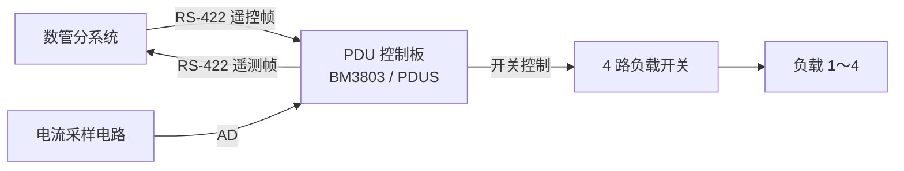
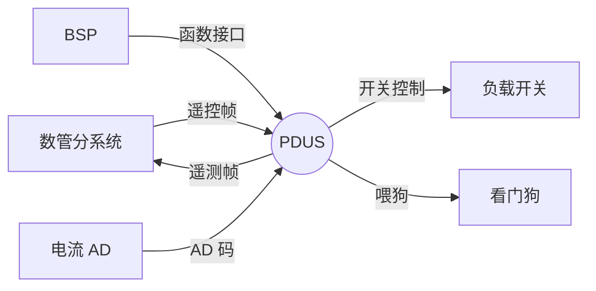
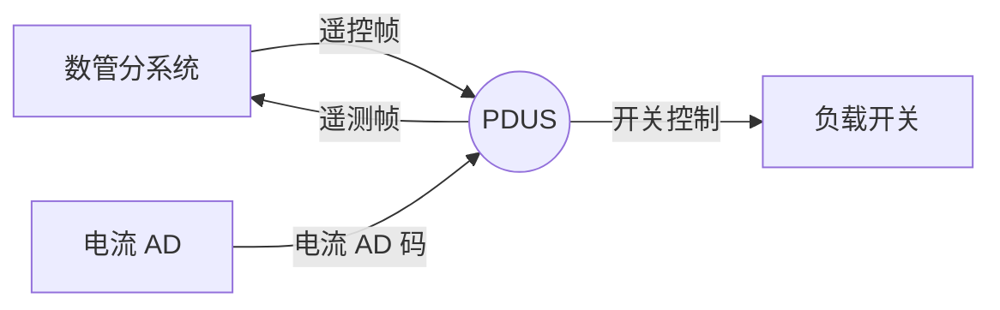
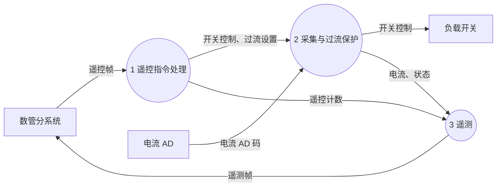

# {{N:XY-9 卫星配电单元软件需求规格说明||O:XY-7 卫星配电单元软件需求规格说明}}

<!-- 虚构示例，用于 AstroLab 评测。fields：{"内容提要":"本文规定了{{N:XY-9||O:XY-7}} 卫星配电单元软件的功能、性能、接口、可靠性安全性等需求。","主题词":"{{N:XY-9||O:XY-7}} 卫星 配电单元软件 需求规格说明","型号代号":"{{N:XY-9||O:XY-7}}"} -->

## 1 引言

### 1.1 配置项基本信息

- 软件名称：{{N:XY-9||O:XY-7}} 卫星配电单元软件（简称 PDUS）
- 软件代号：{{N:R/XY9-PD/01||O:R/XY7-PD/01}}
- 软件研制类型：{{N:Ⅲ类||O:Ⅳ类}}
- 软件安全关键等级：B 级
- 继承基线：{{N:XY-7 卫星配电单元软件 V1.00（R/XY7-PD/01-1.00）||O:无}}
- 软件交办方：天穹卫星总体部（虚构）
- 软件承制方：天穹电子所软件室（虚构）

### 1.2 编写目的

本文档规定 PDUS 的功能、性能、接口、可靠性和安全性需求，作为软件设计、测试和验收的依据。预期读者为软件设计人员、测试人员、质量保证人员和总体人员。

### 1.3 缩略语定义

| 缩略语 | 中文解释，英文全文 |
|---|---|
| AD | 模数转换，Analog to Digital |
| BSP | 板级支持包，Board Support Package |
| PDU | 配电单元，Power Distribution Unit |
| PDUS | 配电单元软件，PDU Software |
| SEU | 单粒子翻转，Single Event Upset |

## 2 引用文件

### 2.1 规范性引用文件

| 编号 | 名称 |
|---|---|
| Q/QJA 30B-2024 | 航天型号软件工程化要求 |
| GJB 8114-2013 | C/C++ 语言编程安全子集 |
| Q/W-Q-80-21-2017 | 航天器软件产品保证技术要素 |

### 2.2 研制依据引用文件

| 编号 | 名称 | 版本或日期 |
|---|---|---|
| {{N:TQ-XY9-RW-PD-2026-01||O:TQ-XY7-RW-PD-2024-03}} | {{N:XY-9||O:XY-7}} 卫星配电单元软件研制任务书 | {{N:A 版，2026-03-01||O:A 版，2024-11-05}} |
| {{N:TQ-XY9-XY-PD-01||O:TQ-XY7-XY-PD-01}} | {{N:XY-9||O:XY-7}} 卫星配电单元与数管分系统通信协议 | {{N:V1.1，2026-04-15||O:V1.0，2024-10-20}} |
| TQ-PDU-YJ-01 | PDU 硬件接口说明 | V1.2，2024-09-30 |
N|| TQ-XY9-PD-QR-01 | XY-9 配电单元软件需求待确认问题答复单 | 2026-04-16 |

## 3 概述

### 3.1 系统组成

配电单元（PDU）由控制板、4 路负载开关和电流采样电路组成。PDU 通过 RS-422 接收数管分系统的遥控指令并发送遥测，控制 4 路负载通道的通断，采集各通道电流，在过流时断开通道。

图 3.1-1 系统组成框图

BM3803 上运行 BSP（硬件组提供，不属于本配置项）和 PDUS 两部分软件，没有操作系统。

### 3.2 软件概述

PDUS 完成遥控指令处理、4 路电流采集与过流保护、遥测组帧发送三项功能。{{N:与 XY-7 基线相比，本软件按任务书增加过流阈值注入、过流判定改为连续 3 次超限断电、遥测增加过流阈值和断电计数。||O:}}

### 3.3 设计约束

| 需求标识 | 约束 |
|---|---|
| PDUS-RREQ4 | 软件运行于 BM3803，不使用操作系统，采用 C 语言编写；底层硬件访问只通过 BSP 接口（见 4.4.1） |

## 4 运行环境规定

### 4.1 运行方案和场景

上电后 BSP 完成处理器初始化并跳转到 PDUS 入口。PDUS 初始化各功能后启动 50 ms 周期定时器：定时中断中完成电流采集和过流保护；主程序按 50 ms 节拍处理遥控指令、每 500 ms 发送一帧遥测并喂狗。

### 4.2 硬件环境

#### 4.2.1 宿主计算机

BM3803 处理器，主频 80 MHz（PDU 硬件接口说明 2.1）。

#### 4.2.2 中断设置

使用定时器 1 中断（50 ms 周期），由 BSP 的 bsp_timer_start 配置；串口接收由 BSP 处理，PDUS 不直接使用其他中断。

#### 4.2.3 看门狗

硬件看门狗溢出时间 1.6 s，溢出后复位处理器（PDU 硬件接口说明 2.4）。

#### 4.2.4 存储器

表 4.2-1 存储器组成和地址分配

| 区域名称 | 组成 | 器件品种 | 单片容量 | 数据宽度 | 总容量 | 地址分配区间 |
|---|---|---|---|---|---|---|
| 引导程序存储器 PROM | 1 片 | PROM | 128 KB | 8 位 | 128 KB | 0x00000000～0x0001FFFF |
| 程序存储器 EEPROM | 1 片 | EEPROM | 512 KB | 32 位 | 512 KB | 0x10000000～0x1007FFFF |
| 数据存储器 SRAM | 2 片 | SRAM | 1 MB | 32 位 | 2 MB | 0x40000000～0x401FFFFF |

表 4.2-2 存储器的使用分配表

| 地址空间 | 容量 | 内容 | 备注 |
|---|---|---|---|
| 0x10000000～0x1003FFFF | 256 KB | BSP 和 PDUS 程序 | |
| 0x40000000～0x400FFFFF | 1 MB | 数据区和堆栈 | |

#### 4.2.5 定时器

定时器 1：周期 50 ms，用于电流采集、过流保护和主程序节拍。

### 4.3 软件编程编译要求

#### 4.3.1 编程要求

| 需求标识 | 要求 |
|---|---|
| PDUS-RREQ5 | 软件编码应符合 GJB 8114-2013《C/C++ 语言编程安全子集》的强制准则 |

#### 4.3.2 编译要求

| 需求标识 | 要求 |
|---|---|
| PDUS-RREQ6 | 使用 BCC 2.0.7 编译，优化等级 -O2，打开 -Wall；最终编译结果应消除所有 warning 报警信息；编译后进行非法指令组合检查 |

### 4.4 接口

图 4.4-1 接口环境图

#### 4.4.1 软件接口

表 4.4-1 系统软件提供给应用软件的函数接口表

| 序号 | 需求标识 | 定义 | 描述 |
|---|---|---|---|
| 1 | PDUS-IREQ1.1 | `U16 bsp_adc_read(U32 ch)` | 读通道电流 AD 码，ch 0～3；正常 0～4095，AD 故障返回 0xFFFF |
| 2 | PDUS-IREQ1.2 | `void bsp_switch_set(U32 ch, U32 on)` | 通道开关，on 1 接通、0 断开 |
| 3 | PDUS-IREQ1.3 | `U32 bsp_uart_read_frame(U8 *buf, U32 max)` | 取一帧遥控数据，返回帧长，无新帧返回 0（帧间隔 ≥ 2 ms 判为一帧，由 BSP 完成） |
| 4 | PDUS-IREQ1.4 | `void bsp_uart_send(const U8 *buf, U32 len)` | 发送遥测帧 |
| 5 | PDUS-IREQ1.5 | `U32 bsp_int_lock(void)`、`void bsp_int_unlock(U32 key)` | 关中断、恢复中断 |
| 6 | PDUS-IREQ1.6 | `void bsp_wdt_feed(void)` | 喂狗 |
| 7 | PDUS-IREQ1.7 | `void bsp_timer_start(U32 period_ms, void (*isr)(void))` | 启动周期定时器 |

表 4.4-2 应用软件提供给系统软件的函数接口表：无。

表 4.4-3 系统软件提供给应用软件的变量接口表：无。

#### 4.4.2 硬件接口

表 4.4-4 硬件接口

| 序号 | 需求标识 | 接口名称 | 接口芯片 | 操作类型 | 操作方向及数据 |
|---|---|---|---|---|---|
| 1 | PDUS-IREQ2.1 | 遥控接口 | RS-422 收发器（经 BSP） | 读 | 数管 → PDU，遥控帧 |
| 2 | PDUS-IREQ2.2 | 遥测接口 | RS-422 收发器（经 BSP） | 写 | PDU → 数管，遥测帧 |
| 3 | PDUS-IREQ2.3 | 电流采集接口 | 12 位 AD（经 BSP） | 读 | 4 路电流 AD 码 |
| 4 | PDUS-IREQ2.4 | 开关控制接口 | 开关驱动电路（经 BSP） | 写 | 4 路通断控制 |

##### 4.4.2.1 遥控接口说明

RS-422，115200 bps，8 位数据、1 位停止、无校验。帧格式按通信协议 5.1：帧头 EB 90、指令码 1 字节、数据域长度 1 字节（0～4）、数据域、累加和 1 字节（指令码到数据域末尾按字节累加取低 8 位）。

##### 4.4.2.2 遥测接口说明

RS-422，参数同遥控接口。每 500 ms 发送一帧，帧长 32 字节，格式按通信协议 5.2，多字节数据高字节在前。

##### 4.4.2.3 电流采集接口说明

4 路，12 位，LSB 2 mA，量程 0～8.19 A（PDU 硬件接口说明 3.2）。AD 故障时 BSP 返回 0xFFFF。

##### 4.4.2.4 开关控制接口说明

4 路，写 1 接通、写 0 断开，上电硬件默认断开（PDU 硬件接口说明 3.3）。

## 5 软件详细需求

### 5.1 功能分解

图 5.1-1 第 0 层数据流图

图 5.1-2 第 1 层数据流图

### 5.2 功能需求

#### 5.2.1 遥控指令处理

遥控指令处理为安全关键功能。{{N:其中过流阈值注入为新状态功能。||O:}}

a. 需求标识：PDUS-FREQ001-K
b. 功能描述：软件应接收遥控帧并校验，校验通过后执行，校验不通过的帧不执行。
c. 调用条件：周期（50 ms）检查是否收到新帧
d. 输入：遥控帧（数管分系统）
e. 输出：遥控正确计数、遥控错误计数、最近指令码（遥测）
f. 处理：
   1. 依次检查帧长不小于 5 字节、帧头为 EB 90、数据域长度不大于 4 且帧长等于数据域长度加 5、累加和正确；
   2. 全部通过后按指令码执行（FREQ002～FREQ00{{N:5||O:4}}），执行成功时遥控正确计数加 1（模 256），最近指令码置为该指令码；
   3. 任一检查不通过或执行失败（指令码未定义、参数错误）时，遥控错误计数加 1（模 256），不改变任何状态。

a. 需求标识：PDUS-FREQ002-K
b. 功能描述：软件应执行通道接通（0x31）和通道断开（0x32）指令。
c. 调用条件：指令（0x31、0x32）
d. 输入：通道号（1～4）
e. 输出：通道开关控制、通道开关状态
f. 处理：
   1. 数据域长度应为 1，通道号为 1～4，否则执行失败；
   2. 0x31 接通指定通道，0x32 断开指定通道，并更新通道开关状态。

a. 需求标识：PDUS-FREQ003-K
b. 功能描述：软件应执行过流保护使能设置指令（0x33）。
c. 调用条件：指令（0x33）
d. 输入：通道号（1～4）、使能码（0x55 使能，0xAA 禁止）
e. 输出：过流保护使能状态
f. 处理：
   1. 数据域长度应为 2，通道号为 1～4，使能码为 0x55 或 0xAA，否则执行失败；
   2. 按使能码设置该通道的过流保护使能状态。

a. 需求标识：PDUS-FREQ004
b. 功能描述：软件应执行清除过流标志指令（0x34）。
c. 调用条件：指令（0x34）
d. 输入：通道号（1～4）
e. 输出：过流标志
f. 处理：
   1. 数据域长度应为 1，通道号为 1～4，否则执行失败；
   2. 清除该通道的过流标志，不改变通道开关状态。

N|a. 需求标识：PDUS-FREQ005-KN
N|b. 功能描述：软件应执行过流阈值注入指令（0x35），设置指定通道的过流阈值。
N|c. 调用条件：指令（0x35）
N|d. 输入：通道号（1～4）、过流阈值（2 字节，高字节在前，LSB 0.01 A）
N|e. 输出：过流阈值（遥测第 17～24 字节）
N|f. 处理：
N|   1. 数据域长度应为 3，通道号为 1～4，否则执行失败；
N|   2. 阈值在 50～500（0.50～5.00 A，含边界）范围内时设置为该通道的过流阈值；
N|   3. 阈值超出范围时执行失败，该通道过流阈值不变。
N|

#### 5.2.2 采集与过流保护

采集与过流保护为安全关键功能。{{N:其中过流判定由“一次超限即断电”改为“连续 3 次超限断电”，为新状态功能。||O:}}

a. 需求标识：PDUS-FREQ011
b. 功能描述：软件应每 50 ms 采集 4 路电流，并判断 AD 数据有效性。
c. 调用条件：周期（50 ms，定时中断）
d. 输入：电流 AD 码（电流 AD）
e. 输出：各通道电流（遥测第 6～13 字节，LSB 0.01 A）、AD 故障标志（遥测第 29 字节）
f. 处理：
   1. AD 码 0～4095 为有效，更新该通道电流值，清该通道连续无效次数和 AD 故障标志；
   2. AD 码大于 4095 为无效，保持上次电流值，该通道本周期不做过流判定；连续 3 次无效时置该通道 AD 故障标志。

a. 需求标识：{{N:PDUS-FREQ012-KN||O:PDUS-FREQ012-K}}
b. 功能描述：软件应对接通且过流保护使能的通道进行过流判定，{{N:连续 3 次采样超过过流阈值||O:采样超过过流阈值（3.00 A）}}时断开该通道。
c. 调用条件：周期（50 ms，定时中断），AD 数据有效时
d. 输入：电流 AD 码、过流保护使能状态、通道开关状态{{N:、过流阈值||O:}}
e. 输出：开关控制、过流标志（遥测第 5 字节）{{N:、断电计数（遥测第 25～28 字节）||O:}}
f. 处理：
O|   1. 通道接通、过流保护使能且电流大于 3.00 A 时，断开该通道，置该通道过流标志；
O|   2. 通道断开或过流保护禁止时不做判定。
N|   1. 通道接通、过流保护使能且电流大于该通道过流阈值时，该通道连续超限次数加 1；电流不大于阈值时连续超限次数清零；
N|   2. 连续超限次数达到 3 时，断开该通道，置该通道过流标志，断电计数加 1（饱和于 255），连续超限次数清零；
N|   3. 通道断开或过流保护禁止时不做判定，连续超限次数清零；
N|   4. 断电计数上电清零，不掉电保持（见 Q-003 答复）。

#### 5.2.3 遥测

a. 需求标识：{{N:PDUS-FREQ021-N||O:PDUS-FREQ021}}
b. 功能描述：软件应每 500 ms 按通信协议 5.2 组遥测帧并发送。
c. 调用条件：周期（500 ms）
d. 输入：通道开关状态、过流保护使能状态、过流标志、各通道电流、遥控计数、最近指令码、AD 故障标志{{N:、过流阈值、断电计数||O:}}
e. 输出：遥测帧（数管分系统）
f. 处理：
   1. 按协议 5.2 填写各字节，电流由 AD 码换算为 0.01 A（AD 码除以 5，取整）；
O|   2. 第 17～28 字节备用，填 0；
N|   2. 第 17～24 字节填 4 路过流阈值（每路 2 字节），第 25～28 字节填 4 路断电计数；
   3. 第 29 字节填 AD 故障标志，第 30 字节填软件版本号（V1.00 为 0x10，V1.01 为 0x11，依此类推），第 31 字节填第 2～30 字节的累加和；
   4. 帧计数每发一帧加 1（模 256）。

### 5.3 性能需求

#### 5.3.1 精度需求

表 5.3-1 精度需求

| 序号 | 需求标识 | 描述 |
|---|---|---|
| 1 | PDUS-PREQ1.1 | 电流采集分辨率 2 mA；遥测电流分辨率 0.01 A |

#### 5.3.2 空间需求

表 5.3-2 空间特性需求

| 序号 | 需求标识 | 描述 |
|---|---|---|
| 1 | PDUS-PREQ2.1 | 程序存储区和数据区使用余量均不小于 20% |

#### 5.3.3 时间特性需求

表 5.3-3 时间特性需求

| 序号 | 需求标识 | 描述 |
|---|---|---|
| 1 | PDUS-PREQ3.1 | 电流采集周期 50 ms ± 1 ms |
N|| 2 | PDUS-PREQ3.2 | 过流断电响应时间不大于 200 ms：从通道电流开始持续超过过流阈值的时刻起，到该通道断开为止（见 Q-002 答复） |
| {{N:3||O:2}} | PDUS-PREQ3.3 | 遥测发送周期 500 ms ± 10 ms |
| {{N:4||O:3}} | PDUS-PREQ3.4 | 收到遥控帧后 100 ms 内执行完毕 |

### 5.4 故障处理要求

| 需求标识 | 故障处理要求 |
|---|---|
| PDUS-RREQ1 | AD 故障：AD 码连续 3 次无效时置该通道 AD 故障标志并在遥测中下传；故障期间保持上次电流值，不做过流判定；AD 恢复有效后清故障标志 |

### 5.5 可靠性及安全性需求

#### 5.5.1 可靠性要求

表 5.5-1 可靠性需求

| 需求标识 | 可靠性要求 |
|---|---|
| PDUS-RREQ2 | 软件应在主程序每个 50 ms 节拍喂狗；程序跑飞或死机时由看门狗（1.6 s）复位 |
N|| PDUS-RREQ3 | 单粒子防护：过流阈值每次使用前检查是否在 50～500 范围内，超出时恢复默认值 300（3.00 A） |
O|| PDUS-RREQ3 | 单粒子防护：过流阈值为程序常量，存放在 EEPROM 中，不受数据区单粒子翻转影响 |

#### 5.5.2 安全性要求

表 5.5-2 安全性需求

| 需求标识 | 安全性要求 |
|---|---|
| PDUS-SREQ1 | 上电初始状态：4 路通道全部断开，过流保护全部使能{{N:，过流阈值均为 3.00 A||O:}} |
| PDUS-SREQ2 | 过流保护禁止的通道不得因过流被软件断开 |
| PDUS-SREQ3 | 未通过校验的遥控帧不得改变任何通道状态和设置 |

### 5.6 复用需求分析

{{N:本软件以 XY-7 卫星配电单元软件 V1.00 为继承基线。遥控帧校验、通道开关、过流使能、清过流标志、电流采集、AD 故障处理完全复用；过流保护（FREQ012）、遥测（FREQ021）、单粒子防护（RREQ3）修改；过流阈值注入（FREQ005）、过流断电响应时间（PREQ3.2）新增。复用情况见附录 B.1 属性列。||O:本软件为新研，无继承基线。遥控帧格式、过流保护功能可供后续型号复用。}}

### 5.7 可维护性需求

| 需求标识 | 可维护性要求 |
|---|---|
| PDUS-RREQ7 | 源程序注释率（按文件统计）不低于 20%；采用结构化设计 |

## 6 专项分析

### 6.1 时序分析

#### 6.1.1 接口时序分析

遥控帧由数管不定期发送，PDUS 每 50 ms 取一帧，满足 PREQ3.4 的 100 ms 要求；遥测每 500 ms 发送 32 字节，115200 bps 下发送时间约 2.8 ms。

#### 6.1.2 中断/任务分析

表 6.1-1 中断分析

| 序号 | 中断描述 | 中断处理 | 中断优先级 | 中断处理时间 | 中断周期/频率 |
|---|---|---|---|---|---|
| 1 | 定时器 1 中断 | 电流采集、过流保护 | 8 | 待实测（估计小于 0.2 ms） | 50 ms |

任务与中断的并发分析：主程序在节拍内处理遥控和遥测，定时中断可在任意时刻打断主程序；两者共享的数据见 6.2。

#### 6.1.3 中断对时间性能影响分析

表 6.1-2 中断对时间性能影响分析

| 序号 | 需求标识 | 功能描述 | 中断打断情况分析 | 中断打断的最大时间分析 | 结论/约束 |
|---|---|---|---|---|---|
| 1 | PDUS-PREQ3.1 | 采集周期 | 采集在中断中进行，不被主程序打断 | 0 | 满足 |
N|| 2 | PDUS-PREQ3.2 | 过流断电响应 | 判定在中断中进行，不被主程序打断 | 最坏情况：超限开始于一次采样之后，第 3 次超限采样在 150 ms 时，加中断处理（小于 0.2 ms）和开关断开时间（不大于 10 ms，PDU 硬件接口说明 3.3），约 160 ms | 满足，需在电性件上实测确认 |
| {{N:3||O:2}} | PDUS-PREQ3.4 | 遥控响应 | 主程序处理可被定时中断打断，每次小于 0.2 ms | 50 ms + 0.2 ms | 满足 |

### 6.2 数据访问冲突分析

表 6.2-1 中断/任务数据访问冲突分析

| 序号 | 中断/任务 | 共享数据分析 | 分析结论 |
|---|---|---|---|
| 1 | 定时中断 / 主程序 | 通道开关状态：主程序（0x31、0x32）和定时中断（过流断开）都改写 | 改写应保证不丢失另一方的修改 |
| 2 | 定时中断 / 主程序 | 过流标志：定时中断置位，主程序（0x34）清除 | 同上 |
N|| 3 | 定时中断 / 主程序 | 过流阈值：主程序（0x35）写，定时中断读 | 定时中断应读到完整的阈值 |

### 6.3 时间系统分析

本软件无时间处理要求，本节裁剪。

### 6.4 数据有效性判断

表 6.4-1 数据有效性判断

| 序号 | 内容 | 硬件层 | 协议层 | 应用层 |
|---|---|---|---|---|
| 1 | 遥控帧 | 帧间隔由 BSP 判定 | 帧头、长度、累加和 | 指令码、通道号、使能码{{N:、阈值范围||O:}} |
| 2 | 电流 AD 码 | AD 故障返回 0xFFFF | — | 0～4095 有效；连续 3 次无效置故障 |

## 7 测试要求

### 7.1 测试环境差异性

确认测试在 PDU 软平台（BSP 仿真）和 PDU 电性件上进行。软平台不能模拟 AD 器件的真实噪声和开关动作时间，过流断电响应时间应在电性件上实测。

### 7.2 健壮性测试

非法遥控帧（帧头、长度、累加和、指令码、通道号、使能码{{N:、阈值||O:}}错误）；AD 故障；遥控帧连续高速发送；上电复位。

### 7.3 不可测试项

| 需求标识 | 说明 | 建议的验证方式 |
|---|---|---|
| PDUS-RREQ3 | {{N:过流阈值单粒子翻转在真实环境下无法触发||O:常量存储，不涉及测试}} | {{N:在软平台上修改内存模拟翻转||O:代码审查}} |

### 7.4 测试要点

表 7.4-1 PDUS 软件测试要点

| 序号 | 测试要点 | 软件测试说明 | 对应的需求功能点 |
|---|---|---|---|
| 1 | 遥控帧校验错误拒收 | 帧头、长度、累加和逐项构造错误帧 | PDUS-FREQ001-K 遥控帧接收与校验 |
| 2 | 保护禁止时不断电 | 禁止后注入过流 | PDUS-SREQ2 |
| 3 | 上电默认状态 | 上电后检查遥测 | PDUS-SREQ1 |
N|| 4 | 过流阈值注入边界 | 0.50 A、5.00 A 可注入；0.49 A、5.01 A 拒收 | PDUS-FREQ005-KN 过流阈值注入 |
N|| 5 | 间断超限不断电 | 超限 2 次后恢复正常 1 次再超限 2 次，通道不应断开；连续 3 次超限应断开 | PDUS-FREQ012-KN 过流保护 |
N|| 6 | 过流断电响应时间 | 用程控负载阶跃到阈值以上，测到通道断开的时间 | PDUS-PREQ3.2 |
O|| 4 | 过流断电 | 电流超过 3.00 A 时断开 | PDUS-FREQ012-K 过流保护 |

## 8 安全关键功能专项要求

### 8.1 安全关键功能对设计的要求

- PDUS-FREQ001-K、PDUS-FREQ002-K、PDUS-FREQ003-K{{N:、PDUS-FREQ005-KN||O:}}：参数逐项检查，检查不通过不改变任何状态。
- {{N:PDUS-FREQ012-KN||O:PDUS-FREQ012-K}}：过流判定在定时中断中进行；与主程序共享的数据按 6.2 处理。

### 8.2 安全关键功能对测试的要求

安全关键功能的测试应覆盖所有参数检查分支和边界值，并在最终版本上回归。

## 9 其他要求

此项无内容。

## 附录A 数据字典

表 PDUS 软件数据字典

| 序号 | 符号 | 物理意义 | 数据类型 | 单位 | 工作范围 |
|---|---|---|---|---|---|
| 1 | 遥控帧 | 数管发来的指令帧 | 字节串 | — | 5～9 字节 |
| 2 | 遥测帧 | 下传状态 | 字节串 | — | 32 字节 |
| 3 | 电流 AD 码 | 通道电流 | 无符号 16 位 | 2 mA | 0～4095 |
| 4 | 通道电流 | 遥测电流 | 无符号 16 位 | 0.01 A | 0～819 |
N|| 5 | 过流阈值 | 各通道过流阈值 | 无符号 16 位 | 0.01 A | 50～500 |
N|| 6 | 断电计数 | 各通道过流断电次数 | 无符号 8 位 | 次 | 0～255 |

## 附录B 需求跟踪矩阵

### 附录B.1 逆向跟踪矩阵

| 序号 | 需求名称 | 需求标识 | 章节号 | 任务需求标识 | 输入文件名称 | 属性 | 可复用需求（说明功能点的复用来源） |
|---|---|---|---|---|---|---|---|
| 1 | 遥控帧接收与校验 | PDUS-FREQ001-K | 5.2.1 | RWS-3.1 | 任务书 | {{N:R、K||O:K}} | {{N:XY-7 PDUS-FREQ001-K||O:}} |
| 2 | 通道接通和断开 | PDUS-FREQ002-K | 5.2.1 | RWS-3.1 | 任务书 | {{N:R、K||O:K}} | {{N:XY-7 PDUS-FREQ002-K||O:}} |
| 3 | 过流保护使能设置 | PDUS-FREQ003-K | 5.2.1 | RWS-3.1 | 任务书 | {{N:R、K||O:K}} | {{N:XY-7 PDUS-FREQ003-K||O:}} |
| 4 | 清除过流标志 | PDUS-FREQ004 | 5.2.1 | RWS-3.1 | 任务书 | {{N:R||O:}} | {{N:XY-7 PDUS-FREQ004||O:}} |
N|| 5 | 过流阈值注入 | PDUS-FREQ005-KN | 5.2.1 | RWS-3.4 | 任务书、通信协议 V1.1 | K、N | |
| {{N:6||O:5}} | 电流采集 | PDUS-FREQ011 | 5.2.2 | RWS-3.2 | 任务书 | {{N:R||O:}} | {{N:XY-7 PDUS-FREQ011||O:}} |
| {{N:7||O:6}} | 过流保护 | {{N:PDUS-FREQ012-KN||O:PDUS-FREQ012-K}} | 5.2.2 | {{N:RWS-3.5||O:RWS-3.2}} | 任务书 | {{N:M、K、N||O:K}} | {{N:XY-7 PDUS-FREQ012-K（判据修改）||O:}} |
| {{N:8||O:7}} | 遥测 | {{N:PDUS-FREQ021-N||O:PDUS-FREQ021}} | 5.2.3 | {{N:RWS-3.3、RWS-3.6||O:RWS-3.3}} | 任务书、通信协议 | {{N:M、N||O:}} | {{N:XY-7 PDUS-FREQ021（增加第 17～28 字节）||O:}} |
| {{N:9||O:8}} | 电流采集精度 | PDUS-PREQ1.1 | 5.3.1 | RWS-4.1 | 任务书 | {{N:R||O:}} | |
| {{N:10||O:9}} | 存储余量 | PDUS-PREQ2.1 | 5.3.2 | RWS-4.2 | 任务书 | {{N:R||O:}} | |
| {{N:11||O:10}} | 采集周期 | PDUS-PREQ3.1 | 5.3.3 | RWS-4.3 | 任务书 | {{N:R||O:}} | |
N|| 12 | 过流断电响应时间 | PDUS-PREQ3.2 | 5.3.3 | RWS-附表1 | 任务书 | N | |
| {{N:13||O:11}} | 遥测周期 | PDUS-PREQ3.3 | 5.3.3 | RWS-4.3 | 任务书 | {{N:R||O:}} | |
| {{N:14||O:12}} | 遥控响应时间 | PDUS-PREQ3.4 | 5.3.3 | RWS-4.3 | 任务书 | {{N:R||O:}} | |
| {{N:15||O:13}} | AD 故障处理 | PDUS-RREQ1 | 5.4 | RWS-5.1 | 任务书 | {{N:R||O:}} | |
| {{N:16||O:14}} | 看门狗 | PDUS-RREQ2 | 5.5.1 | RWS-5.2 | 任务书 | {{N:R||O:}} | |
| {{N:17||O:15}} | 单粒子防护 | PDUS-RREQ3 | 5.5.1 | RWS-5.3 | 任务书 | {{N:M、N||O:}} | |
| {{N:18||O:16}} | 运行平台约束 | PDUS-RREQ4 | 3.3 | RWS-6.1 | 任务书 | {{N:R||O:}} | |
| {{N:19||O:17}} | 编程规范 | PDUS-RREQ5 | 4.3.1 | RWS-6.2 | 任务书 | {{N:R||O:}} | |
| {{N:20||O:18}} | 编译要求 | PDUS-RREQ6 | 4.3.2 | RWS-6.3 | 任务书 | {{N:R||O:}} | |
| {{N:21||O:19}} | 注释率 | PDUS-RREQ7 | 5.7 | RWS-6.4 | 任务书 | {{N:R||O:}} | |
| {{N:22||O:20}} | 上电初始状态 | PDUS-SREQ1 | 5.5.2 | RWS-5.4 | 任务书 | {{N:M||O:}} | |
| {{N:23||O:21}} | 禁止时不断电 | PDUS-SREQ2 | 5.5.2 | RWS-5.4 | 任务书 | {{N:R||O:}} | |
| {{N:24||O:22}} | 错误帧不执行 | PDUS-SREQ3 | 5.5.2 | RWS-5.4 | 任务书 | {{N:R||O:}} | |
| {{N:25||O:23}} | BSP 接口：读电流 AD 码 | PDUS-IREQ1.1 | 4.4.1 | RWS-6.1 | 硬件接口说明 | {{N:R||O:}} | |
| {{N:26||O:24}} | BSP 接口：通道开关 | PDUS-IREQ1.2 | 4.4.1 | RWS-6.1 | 硬件接口说明 | {{N:R||O:}} | |
| {{N:27||O:25}} | BSP 接口：取遥控帧 | PDUS-IREQ1.3 | 4.4.1 | RWS-6.1 | 硬件接口说明 | {{N:R||O:}} | |
| {{N:28||O:26}} | BSP 接口：发送遥测帧 | PDUS-IREQ1.4 | 4.4.1 | RWS-6.1 | 硬件接口说明 | {{N:R||O:}} | |
| {{N:29||O:27}} | BSP 接口：关中断、恢复中断 | PDUS-IREQ1.5 | 4.4.1 | RWS-6.1 | 硬件接口说明 | {{N:R||O:}} | |
| {{N:30||O:28}} | BSP 接口：喂狗 | PDUS-IREQ1.6 | 4.4.1 | RWS-6.1 | 硬件接口说明 | {{N:R||O:}} | |
| {{N:31||O:29}} | BSP 接口：启动周期定时器 | PDUS-IREQ1.7 | 4.4.1 | RWS-6.1 | 硬件接口说明 | {{N:R||O:}} | |
| {{N:32||O:30}} | 遥控接口 | PDUS-IREQ2.1 | 4.4.2 | RWS-3.1 | 通信协议 | {{N:R||O:}} | |
| {{N:33||O:31}} | 遥测接口 | PDUS-IREQ2.2 | 4.4.2 | RWS-3.3 | 通信协议 | {{N:M||O:}} | |
| {{N:34||O:32}} | 电流采集接口 | PDUS-IREQ2.3 | 4.4.2 | RWS-3.2 | 硬件接口说明 | {{N:R||O:}} | |
| {{N:35||O:33}} | 开关控制接口 | PDUS-IREQ2.4 | 4.4.2 | RWS-3.1 | 硬件接口说明 | {{N:R||O:}} | |

注 1：属性包括可复用(R)、修改(M)、新状态(N)、安全关键(K)。注 2：表中章节号为可选项，可根据实际情况进行裁剪。

### 附录B.2 正向跟踪矩阵（跟踪任务书）

| 序号 | 任务标识 | 任务要求项 | 需求标识 | 需求项 |
|---|---|---|---|---|
| 1 | RWS-3.1 | 遥控指令处理 | PDUS-FREQ001-K、PDUS-FREQ002-K、PDUS-FREQ003-K、PDUS-FREQ004 | 遥控帧校验和各指令 |
| 2 | RWS-3.2 | 电流采集{{N:||O:和过流保护}} | PDUS-FREQ011{{N:||O:、PDUS-FREQ012-K}} | 电流采集{{N:||O:、过流保护}} |
| 3 | RWS-3.3 | 遥测 | {{N:PDUS-FREQ021-N||O:PDUS-FREQ021}} | 遥测 |
N|| 4 | RWS-3.4 | 过流阈值可注入（CHG-1） | PDUS-FREQ005-KN | 过流阈值注入 |
N|| 5 | RWS-3.5 | 连续 3 次超限断电（CHG-2） | PDUS-FREQ012-KN、PDUS-PREQ3.2 | 过流保护、响应时间 |
N|| 6 | RWS-3.6 | 遥测增加过流阈值和断电计数（CHG-1、CHG-3） | PDUS-FREQ021-N | 遥测 |
| {{N:7||O:4}} | RWS-4 | 性能 | PDUS-PREQ1.1～PREQ3.4 | 性能需求 |
| {{N:8||O:5}} | RWS-5 | 可靠性安全性 | PDUS-RREQ1～RREQ3、PDUS-SREQ1～SREQ3 | 可靠性安全性需求 |
| {{N:9||O:6}} | RWS-6 | 设计约束和编程编译 | PDUS-RREQ4～RREQ7、PDUS-IREQ1.1～IREQ1.7 | 约束和接口 |

## 附录C 分配需求更动记录

O|V1.00 为首版，无更动记录。
N|XY-9 适应性更改（相对 XY-7 PDUS V1.00 的分配基线）：
N|
N|| 序号 | 变更的需求项名称 | 变更的需求标识 | 需求规格说明更改内容 | 更动的输入文件 | 功能基线更动内容 | 影响分析 | 验证方式 |
N||---|---|---|---|---|---|---|---|
N|| 1 | 过流阈值注入 | PDUS-FREQ005-KN | 新增 | 任务书 CHG-1；通信协议 V1.1 | 新增 0x35 指令 | 影响遥控处理、过流判定、遥测 | 确认测试（边界、异常） |
N|| 2 | 过流保护 | PDUS-FREQ012-KN | 判据改为连续 3 次超限 | 任务书 CHG-2 | 过流判据 | 影响断电响应时间（新增 PREQ3.2） | 确认测试（间断超限、响应时间） |
N|| 3 | 遥测 | PDUS-FREQ021-N | 第 17～28 字节由备用改为阈值和断电计数 | 任务书 CHG-1、CHG-3 | 遥测内容 | 仅影响遥测组帧 | 确认测试 |
N|| 4 | 单粒子防护 | PDUS-RREQ3 | 阈值由常量改为变量后增加使用前检查 | 任务书 5.3 | 可靠性措施 | 影响过流判定 | 软平台内存注入 |
N|| 5 | 过流断电响应时间 | PDUS-PREQ3.2 | 新增 | 任务书附表 1 | 新增性能指标 | — | 确认测试（电性件实测） |

## 附录D 《软件需求规格说明书》-需求分析阶段确认检查表

| 序号 | 要素类别 | 要素名称 | 检查项 | 对应章节 | 产保工程师检查确认结果 |
|---|---|---|---|---|---|
| 1 | 过程控制 | 新状态识别与控制 | 在软件需求规格说明对新状态进行标识、分解、分析 | 附录 B.1 属性列 | |
| 2 | 过程控制 | 安全关键功能识别与控制 | 在需求规格说明中对安全关键功能进行分解，提出可靠性安全性设计和验证的需求，在跟踪矩阵中进行跟踪 | 附录 B.1、第 8 章 | |
| 3 | 过程控制 | 软件技术状态变更控制 | 在需求规格说明中针对功能基线的变更内容逐项进行标识、影响分析，给出验证方式 | 附录 C | |
| 4 | 过程控制 | 不可测试项分析与控制 | 在需求规格说明中，对测试阶段的不可测试项分析与控制提出要求 | 7.3 | |
| 5 | 过程控制 | 测试环境差异性分析与控制 | 在需求规格说明中，对测试阶段的测试环境差异性分析与控制提出要求 | 7.1 | |
| 6 | 开发设计 | 数据访问冲突分析与设计 | 在分系统（单机）需求分析阶段，明确相关中断、任务划分，以及中断频率、时序特性等 | 6.1 | |
| 7 | 开发设计 | 数据访问冲突分析与设计 | 在需求规格说明中，识别具有原子属性的数据或资源，对这些数据或资源的使用提出要求 | 6.2 | |
| 8 | 开发设计 | 数据有效性判断设计 | 在需求规格说明中，给出输入数据的来源、判断条件、判断方法、判断结果的生存时间、数据无效时的处理策略等 | 6.4 | |
| 9 | 开发设计 | 单粒子防护设计 | 在需求规格说明中，给出发生单粒子效应的情况下软件的处理要求 | 5.5.1 | |
| 10 | 开发设计 | 时序设计 | 在需求规格说明中，对系统级时序要求进行细化，对时序关键点提出性能指标 | 6.1 | |
| 11 | 开发设计 | 时间系统设计 | 在需求规格说明中，对时间系统的设计和维护提出要求 | 不适用：6.3 无时间处理要求 | |
| 12 | 编程编译 | 编程规范性 | 在需求规格说明中，明确提出编码实现需要遵循的规范要求 | 4.3.1 | |
| 13 | 编程编译 | 编译规范性 | 在需求规格说明中，对软件编译规范性提出要求 | 4.3.2 | |
| 14 | 测试验证 | 健壮性验证 | 在需求规格说明中，提出需开展健壮性验证的项目 | 7.2 | |
| 15 | 测试验证 | 测试要点验证 | 在软件需求规格说明中，将每项测试要点落实到需求功能点当中 | 7.4 | |

注 1：各单位/型号依据单位/型号制定的专用产保技术要素，并将专用要素内容落实在相应阶段的文档模板中，并制定相应的检查项，在通用产保技术要素检查单之后进行补充。
注 2：对应章节一列，各软件配置项报告需根据实际情况进行填写，本模板中仅为示例。
