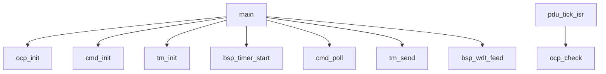
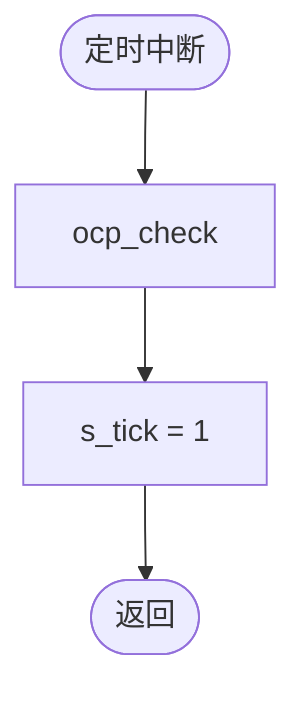
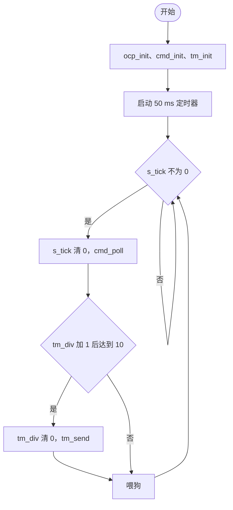
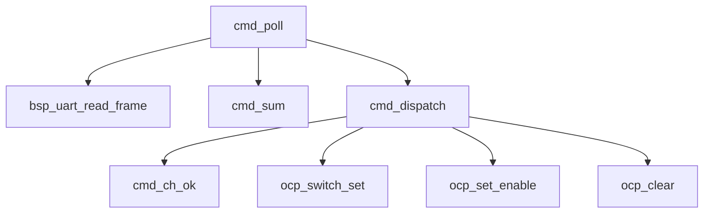
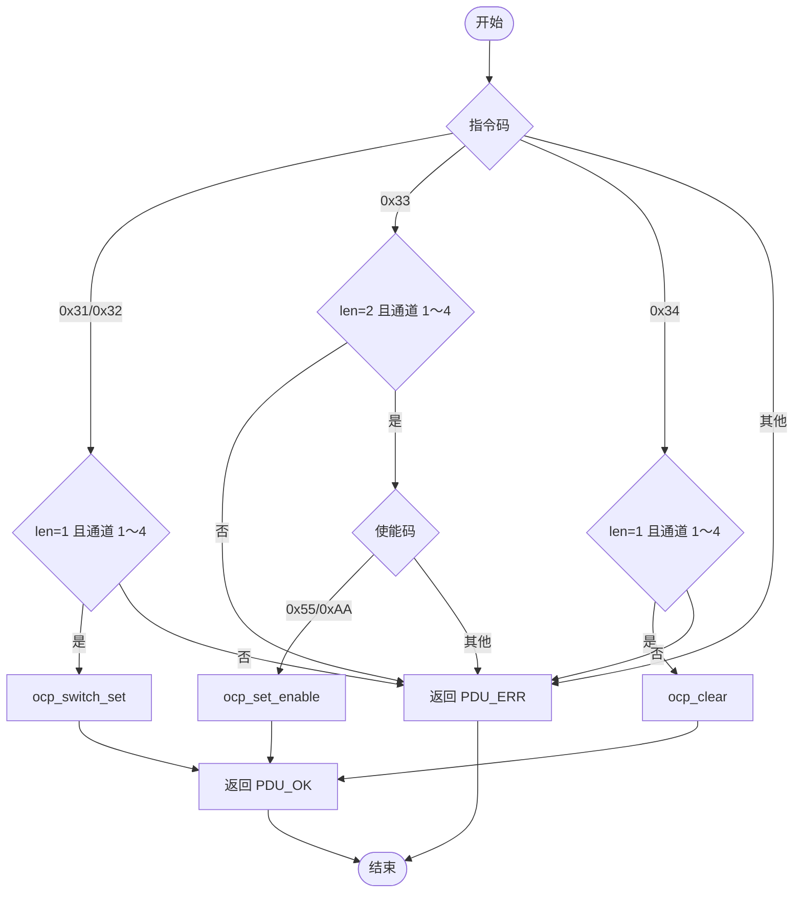
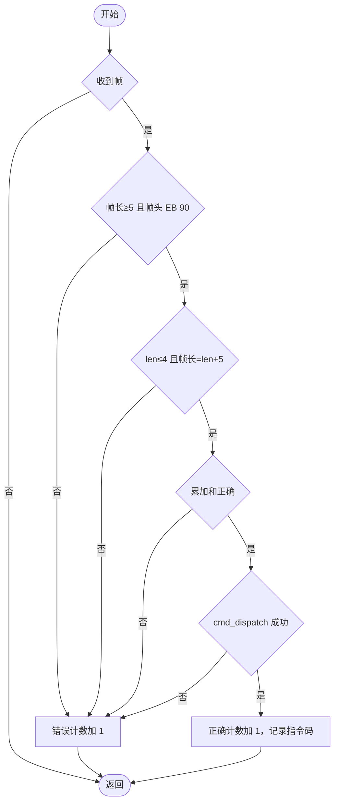
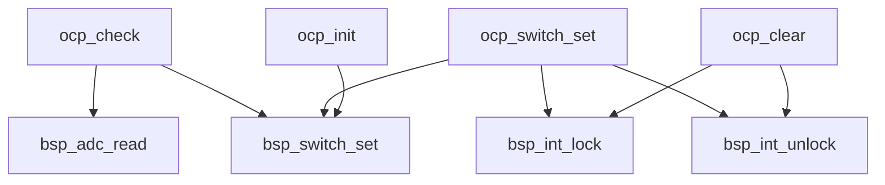
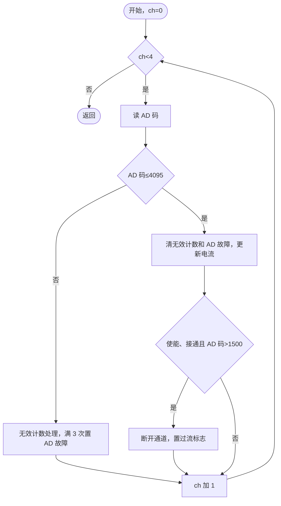
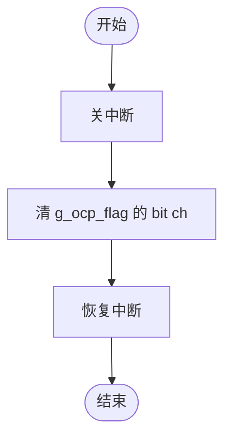
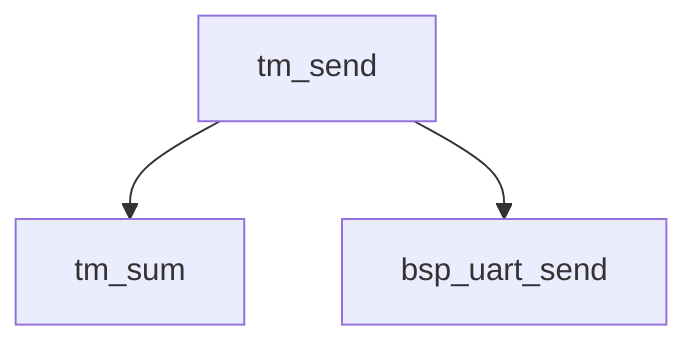

# XY-7 卫星配电单元软件详细设计说明

## 1 范围

### 1.1 标识

- 软件名称：XY-7 卫星配电单元软件（PDUS）
- 软件代号：R/XY7-PD/01
- 交办方：天穹卫星总体部（虚构）
- 承制方：天穹电子所软件室（虚构）
- 安全关键等级：B 级
- 软件类型：嵌入式应用软件（Ⅳ类）

### 1.2 系统概述

PDUS 运行于 PDU 控制板（BM3803），完成遥控指令处理、4 路电流采集与过流保护、遥测组帧发送，与需求规格说明 3.2 一致。

### 1.3 文档概述

本文档为正向设计，供软件设计、编码、测试（尤其是单元测试）和维护人员使用。本版本对应软件 V1.00。

### 1.4 术语和缩略语

同需求规格说明 1.3。

### 1.5 技术状态变更

表 1-1 详细设计说明技术状态变更情况

| 序号 | 变更类型 | 状态差异描述：内容概述（—） | 状态差异描述：内容概述（V1.00） |
|---|---|---|---|
| 1 | 首版 | — | 首版，无技术状态变更 |

## 2 引用文件

| 文档号 | 标题 | 版本 |
|---|---|---|
| GJB 8114-2013 | C/C++ 语言编程安全子集 | — |
| TQ-XY7-PD-XQ-01 | XY-7 卫星配电单元软件需求规格说明 | V1.0 |
| TQ-XY7-XY-PD-01 | 配电单元与数管分系统通信协议 | V1.0 |
| TQ-PDU-YJ-01 | PDU 硬件接口说明 | V1.2 |

## 3 总体设计

### 3.1 系统组成

见需求规格说明 3.1。PDUS 通过 BSP 函数访问硬件（需求规格说明 4.4.1）。

### 3.2 软件开发环境及约束

BCC 2.0.7，-O2 -Wall；编码遵循 GJB 8114-2013 强制准则；编译结果无告警（PDUS-RREQ5、RREQ6）。

### 3.3 运行环境

#### 3.3.1 硬件环境

BM3803，80 MHz；程序区 256 KB，数据区 1 MB；余量要求 20%（PDUS-PREQ2.1）。

#### 3.3.2 软件环境

无（不使用操作系统，使用硬件组提供的 BSP）。

### 3.4 软件功能描述

遥控指令处理（PDUS-FREQ001-K～FREQ004）；电流采集与过流保护（PDUS-FREQ011、FREQ012-K）；遥测（PDUS-FREQ021）。

### 3.5 设计决策

#### 3.5.1 设计决策

| 编号 | 决策 | 理由 | 影响 |
|---|---|---|---|
| D-001 | 电流采集和过流判定在 50 ms 定时中断中执行，遥控和遥测在主循环中执行 | 过流保护不受主循环处理时间影响 | 中断与主循环共享通道开关状态、过流标志，见 4.4.1 |
| D-002 | 通道号在 cmd 模块中检查并换算为 0～3，ocp 模块的函数不再检查通道号 | 只在一处检查 | ocp 函数的调用者须保证通道号有效 |

#### 3.5.2 备选方案

无（3.5.1 中的决策不涉及备选方案比较）。

#### 3.5.3 选择准则

无（3.5.1 中的决策不涉及备选方案比较）。

#### 3.5.4 选取的最佳备选方案

无（3.5.1 中的决策不涉及备选方案比较）。

### 3.6 复用说明

表 4-1 复用情况表

| 序号 | 函数标识 | 函数名称 | 复用方式 | 被复用函数标识 | 被复用函数名称 | 被复用函数版本 |
|---|---|---|---|---|---|---|
| — | 无 | | | | | |

## 4 CSCI 详细设计

### 4.1 体系结构设计

| 部件标识（PD） | 部件名称 | 本文档章节 | 状态 |
|---|---|---|---|
| main | 主程序 | 4.2 | 已设计（4.2） |
| cmd | 遥控指令处理 | 4.3 | 已设计（4.3） |
| ocp | 通道控制与过流保护 | 4.4 | 已设计（4.4） |
| tm | 遥测 | 4.5 | 已设计（4.5） |

### 4.2 main 模块详细设计

#### 4.2.1 模块设计

1. 概要设计规定：初始化各模块，启动 50 ms 定时器；主循环按节拍调用 cmd_poll，每 10 个节拍调用 tm_send，喂狗（PDUS-RREQ2）。
2. 软件单元划分：

| 单元标识（DD） | 单元名称 | 类型 | 调用者 | 执行环境 |
|---|---|---|---|---|
| pdu_tick_isr | 定时中断服务 | 内部函数（static） | BSP 定时器 | 中断 |
| main | 主程序 | 对外函数 | BSP 启动代码 | 主循环 |

3. 调用关系：

4. 运行流程：定时中断每 50 ms 执行 ocp_check 后置节拍标志；主循环检测到节拍标志后清标志并处理。
5. 模块数据：

| 名称 | 类型 | 初值 | 取值范围 | 读写者 | 保护 |
|---|---|---|---|---|---|
| s_tick | static volatile U32 | 0 | 0、1 | pdu_tick_isr（中断，写 1）、main（主循环，读、写 0） | volatile，单次读写，不需关中断 |

#### 4.2.2 pdu_tick_isr 软件单元设计

##### 4.2.2.1 简述

a) 功能概述：50 ms 定时中断，调用 ocp_check 后置节拍标志。
b) 设计思路：采集和保护放在中断中，见 D-001。
c) 设计约束：中断中执行，执行时间小于 0.2 ms（待实测）。
d) 对应的需求：PDUS-PREQ3.1、PDUS-FREQ011

##### 4.2.2.2 输入输出

函数原型：`static void pdu_tick_isr(void)`

表 4.2.2-1 函数的形参表和返回值

| 类型 | 长度 | 参数名称 | 描述 |
|---|---|---|---|
| void | — | 返回值 | 无 |

表 4.2.2-2 数据元素表

| 数据名称 | 数据来源 | 判断条件 | 有效性判断方法 | 判断结果生存时间 | 数据无效时的处理策略 |
|---|---|---|---|---|---|
| 无 | | | | | |

表 4.2.2-3 全局变量或资源表

| 全局变量或资源名称 | 使用方法 | 是否具有原子属性 | 防止原子属性被破坏的解决措施 |
|---|---|---|---|
| s_tick | 写 1 | 否 | — |

表 4.2.2-4 中断和信号量表

| 中断和信号量名称 | 发起或处理方法 |
|---|---|
| 定时器 1 中断 | 处理 |

##### 4.2.2.3 局部变量及数据结构

无。

##### 4.2.2.4 处理流程

1. 调用 ocp_check。
2. s_tick 置 1。

##### 4.2.2.5 限制条件

中断中执行，不调用阻塞函数。

##### 4.2.2.6 其他

调用的函数：ocp_check。

#### 4.2.3 main 软件单元设计

##### 4.2.3.1 简述

a) 功能概述：初始化并运行主循环。
b) 设计思路：节拍驱动的前后台结构。
c) 设计约束：不返回。
d) 对应的需求：PDUS-RREQ2、PDUS-PREQ3.3、PDUS-PREQ3.4、PDUS-SREQ1

##### 4.2.3.2 输入输出

函数原型：`int main(void)`

表 4.2.3-1 函数的形参表和返回值

| 类型 | 长度 | 参数名称 | 描述 |
|---|---|---|---|
| int | 4 字节 | 返回值 | 不返回 |

表 4.2.3-2 数据元素表

| 数据名称 | 数据来源 | 判断条件 | 有效性判断方法 | 判断结果生存时间 | 数据无效时的处理策略 |
|---|---|---|---|---|---|
| 无 | | | | | |

表 4.2.3-3 全局变量或资源表

| 全局变量或资源名称 | 使用方法 | 是否具有原子属性 | 防止原子属性被破坏的解决措施 |
|---|---|---|---|
| s_tick | 读、写 0 | 否 | — |

表 4.2.3-4 中断和信号量表

| 中断和信号量名称 | 发起或处理方法 |
|---|---|
| 定时器 1 中断 | 通过 bsp_timer_start 启动 |

##### 4.2.3.3 局部变量及数据结构

表 4.2.3-5 局部变量及数据结构

| 类型 | 长度 | 参数名称 | 描述 |
|---|---|---|---|
| U32 | 4 字节 | tm_div | 遥测分频计数，0～9 |

##### 4.2.3.4 处理流程

1. 依次调用 ocp_init、cmd_init、tm_init；调用 bsp_timer_start(50, pdu_tick_isr)。
2. 循环：s_tick 不为 0 时，s_tick 清 0，调用 cmd_poll；tm_div 加 1，达到 10 时清 0 并调用 tm_send；调用 bsp_wdt_feed。

##### 4.2.3.5 限制条件

初始化在启动定时器之前完成，保证上电状态（PDUS-SREQ1）。

##### 4.2.3.6 其他

调用的函数：ocp_init、cmd_init、tm_init、bsp_timer_start、cmd_poll、tm_send、bsp_wdt_feed。

### 4.3 cmd 模块详细设计

#### 4.3.1 模块设计

1. 概要设计规定：接收、校验、执行遥控帧，维护遥控计数（PDUS-FREQ001-K～FREQ004）。
2. 软件单元划分：

| 单元标识（DD） | 单元名称 | 类型 | 调用者 | 执行环境 |
|---|---|---|---|---|
| cmd_sum | 累加和 | 内部函数（static） | cmd_poll | 主循环 |
| cmd_ch_ok | 通道号检查 | 内部函数（static） | cmd_dispatch | 主循环 |
| cmd_dispatch | 指令执行 | 内部函数（static） | cmd_poll | 主循环 |
| cmd_init | 初始化 | 对外函数 | main | 主循环 |
| cmd_poll | 遥控处理 | 对外函数 | main | 主循环 |

3. 调用关系：

4. 运行流程：主循环每 50 ms 调用 cmd_poll 一次，每次最多处理一帧。
5. 模块数据：

常量：

| 名称 | 值 | 含义 | 依据 |
|---|---|---|---|
| CMD_DATA_MAX | 4 | 数据域最大长度 | 通信协议 5.1 |
| CMD_FIX_LEN | 5 | 帧头 2 + 指令码 1 + 长度 1 + 校验和 1 | 通信协议 5.1 |

全局和静态变量：

| 名称 | 类型 | 初值 | 取值范围 | 读写者 | 保护 |
|---|---|---|---|---|---|
| g_cmd_ok_cnt | U32 | 0 | 0～255 | cmd_poll（写）、tm_send（读），均为主循环 | 只在主循环中访问，不需保护 |
| g_cmd_err_cnt | U32 | 0 | 0～255 | 同上 | 只在主循环中访问，不需保护 |
| g_cmd_last | U32 | 0 | 0～255 | 同上 | 只在主循环中访问，不需保护 |
| s_buf | static U8[16] | — | — | cmd_poll（主循环） | 只在主循环中访问，不需保护 |

#### 4.3.2 cmd_sum 软件单元设计

##### 4.3.2.1 简述

a) 功能概述：计算字节累加和，取低 8 位。
b) 设计思路：32 位累加后取低 8 位。
c) 设计约束：主循环调用。
d) 对应的需求：内部函数，支持 cmd_poll（PDUS-FREQ001-K）

##### 4.3.2.2 输入输出

函数原型：`static U8 cmd_sum(const U8 *p, U32 n)`

表 4.3.2-1 函数的形参表和返回值

| 类型 | 长度 | 参数名称 | 描述 |
|---|---|---|---|
| const U8 * | 4 字节 | p | 数据首地址，非空 |
| U32 | 4 字节 | n | 字节数，0～16 |
| U8 | 1 字节 | 返回值 | 累加和低 8 位 |

表 4.3.2-2 数据元素表

| 数据名称 | 数据来源 | 判断条件 | 有效性判断方法 | 判断结果生存时间 | 数据无效时的处理策略 |
|---|---|---|---|---|---|
| 无 | | | | | |

表 4.3.2-3 全局变量或资源表

| 全局变量或资源名称 | 使用方法 | 是否具有原子属性 | 防止原子属性被破坏的解决措施 |
|---|---|---|---|
| 无 | | | |

表 4.3.2-4 中断和信号量表

| 中断和信号量名称 | 发起或处理方法 |
|---|---|
| 无 | |

##### 4.3.2.3 局部变量及数据结构

表 4.3.2-5 局部变量及数据结构

| 类型 | 长度 | 参数名称 | 描述 |
|---|---|---|---|
| U32 | 4 字节 | sum | 累加值 |

##### 4.3.2.4 处理流程

1. sum 置 0，依次加上 p[0]～p[n−1]。
2. 返回 sum 的低 8 位。

##### 4.3.2.5 限制条件

n 为 0 时返回 0。

##### 4.3.2.6 其他

无。

#### 4.3.3 cmd_ch_ok 软件单元设计

##### 4.3.3.1 简述

a) 功能概述：检查通道号是否为 1～4。
b) 设计思路：区间比较。
c) 设计约束：主循环调用。
d) 对应的需求：内部函数，支持 cmd_dispatch（PDUS-FREQ002-K～FREQ004）

##### 4.3.3.2 输入输出

函数原型：`static U32 cmd_ch_ok(U32 ch)`

表 4.3.3-1 函数的形参表和返回值

| 类型 | 长度 | 参数名称 | 描述 |
|---|---|---|---|
| U32 | 4 字节 | ch | 协议中的通道号 |
| U32 | 4 字节 | 返回值 | 1：ch 为 1～4（含端点）；0：其他 |

表 4.3.3-2 数据元素表

| 数据名称 | 数据来源 | 判断条件 | 有效性判断方法 | 判断结果生存时间 | 数据无效时的处理策略 |
|---|---|---|---|---|---|
| 通道号 | 遥控帧数据域 | 1～4 | 区间比较 | 本条指令 | 指令执行失败 |

表 4.3.3-3 全局变量或资源表

| 全局变量或资源名称 | 使用方法 | 是否具有原子属性 | 防止原子属性被破坏的解决措施 |
|---|---|---|---|
| 无 | | | |

表 4.3.3-4 中断和信号量表

| 中断和信号量名称 | 发起或处理方法 |
|---|---|
| 无 | |

##### 4.3.3.3 局部变量及数据结构

无。

##### 4.3.3.4 处理流程

1. ch 不小于 1 且不大于 4 时返回 1，否则返回 0。

##### 4.3.3.5 限制条件

无。

##### 4.3.3.6 其他

无。

#### 4.3.4 cmd_dispatch 软件单元设计

##### 4.3.4.1 简述

a) 功能概述：按指令码检查参数并执行。
b) 设计思路：switch 分发；每条指令先检查数据域长度和通道号。
c) 设计约束：主循环调用。
d) 对应的需求：PDUS-FREQ002-K、PDUS-FREQ003-K、PDUS-FREQ004、PDUS-SREQ3

##### 4.3.4.2 输入输出

函数原型：`static U32 cmd_dispatch(U32 code, const U8 *d, U32 len)`

表 4.3.4-1 函数的形参表和返回值

| 类型 | 长度 | 参数名称 | 描述 |
|---|---|---|---|
| U32 | 4 字节 | code | 指令码 |
| const U8 * | 4 字节 | d | 数据域首地址 |
| U32 | 4 字节 | len | 数据域长度，0～4 |
| U32 | 4 字节 | 返回值 | PDU_OK：执行成功；PDU_ERR：指令码未定义、长度或参数错误 |

表 4.3.4-2 数据元素表

| 数据名称 | 数据来源 | 判断条件 | 有效性判断方法 | 判断结果生存时间 | 数据无效时的处理策略 |
|---|---|---|---|---|---|
| 指令码 | 遥控帧 | 0x31～0x34 | 枚举 | 本条指令 | 返回 PDU_ERR |
| 使能码 | 0x33 数据域 | 0x55 或 0xAA | 枚举 | 本条指令 | 返回 PDU_ERR |

表 4.3.4-3 全局变量或资源表

| 全局变量或资源名称 | 使用方法 | 是否具有原子属性 | 防止原子属性被破坏的解决措施 |
|---|---|---|---|
| 无（通过 ocp 函数修改状态） | | | |

表 4.3.4-4 中断和信号量表

| 中断和信号量名称 | 发起或处理方法 |
|---|---|
| 无 | |

##### 4.3.4.3 局部变量及数据结构

表 4.3.4-5 局部变量及数据结构

| 类型 | 长度 | 参数名称 | 描述 |
|---|---|---|---|
| U32 | 4 字节 | ret | 返回值，初值 PDU_ERR |

##### 4.3.4.4 处理流程

1. 0x31：len 为 1 且 cmd_ch_ok(d[0]) 为 1 时调用 ocp_switch_set(d[0]−1, 1)，返回 PDU_OK。
2. 0x32：同上，调用 ocp_switch_set(d[0]−1, 0)。
3. 0x33：len 为 2 且通道号有效时，d[1] 为 0x55 调用 ocp_set_enable(d[0]−1, 1)，为 0xAA 调用 ocp_set_enable(d[0]−1, 0)，返回 PDU_OK；其他使能码返回 PDU_ERR。
4. 0x34：len 为 1 且通道号有效时调用 ocp_clear(d[0]−1)，返回 PDU_OK。
5. 其他指令码，或以上长度、通道号检查不通过，返回 PDU_ERR。

##### 4.3.4.5 限制条件

参数检查在调用 ocp 函数之前，检查不通过不改变任何状态（PDUS-SREQ3）。

##### 4.3.4.6 其他

调用的函数：cmd_ch_ok、ocp_switch_set、ocp_set_enable、ocp_clear。

#### 4.3.5 cmd_init 软件单元设计

##### 4.3.5.1 简述

a) 功能概述：遥控计数和最近指令码清零。
b) 设计思路：直接赋值。
c) 设计约束：main 初始化时调用。
d) 对应的需求：PDUS-FREQ001-K

##### 4.3.5.2 输入输出

函数原型：`void cmd_init(void)`

表 4.3.5-1 函数的形参表和返回值

| 类型 | 长度 | 参数名称 | 描述 |
|---|---|---|---|
| void | — | 返回值 | 无 |

表 4.3.5-2 数据元素表

| 数据名称 | 数据来源 | 判断条件 | 有效性判断方法 | 判断结果生存时间 | 数据无效时的处理策略 |
|---|---|---|---|---|---|
| 无 | | | | | |

表 4.3.5-3 全局变量或资源表

| 全局变量或资源名称 | 使用方法 | 是否具有原子属性 | 防止原子属性被破坏的解决措施 |
|---|---|---|---|
| g_cmd_ok_cnt、g_cmd_err_cnt、g_cmd_last | 写 0 | 否 | — |

表 4.3.5-4 中断和信号量表

| 中断和信号量名称 | 发起或处理方法 |
|---|---|
| 无 | |

##### 4.3.5.3 局部变量及数据结构

无。

##### 4.3.5.4 处理流程

1. g_cmd_ok_cnt、g_cmd_err_cnt、g_cmd_last 置 0。

##### 4.3.5.5 限制条件

无。

##### 4.3.5.6 其他

无。

#### 4.3.6 cmd_poll 软件单元设计

##### 4.3.6.1 简述

a) 功能概述：取一帧遥控数据，校验后执行，更新遥控计数。
b) 设计思路：按帧头、长度、累加和的顺序检查，全部通过才执行。
c) 设计约束：主循环每 50 ms 调用一次，可被定时中断打断。
d) 对应的需求：PDUS-FREQ001-K、PDUS-SREQ3、PDUS-PREQ3.4

##### 4.3.6.2 输入输出

函数原型：`void cmd_poll(void)`

表 4.3.6-1 函数的形参表和返回值

| 类型 | 长度 | 参数名称 | 描述 |
|---|---|---|---|
| void | — | 返回值 | 无 |

表 4.3.6-2 数据元素表

| 数据名称 | 数据来源 | 判断条件 | 有效性判断方法 | 判断结果生存时间 | 数据无效时的处理策略 |
|---|---|---|---|---|---|
| 遥控帧 | bsp_uart_read_frame | 帧长 ≥ 5；帧头 EB 90；数据域长度 ≤ 4 且帧长 = 数据域长度 + 5；累加和正确 | 按顺序逐项检查 | 本帧 | 丢弃，遥控错误计数加 1 |

表 4.3.6-3 全局变量或资源表

| 全局变量或资源名称 | 使用方法 | 是否具有原子属性 | 防止原子属性被破坏的解决措施 |
|---|---|---|---|
| g_cmd_ok_cnt、g_cmd_err_cnt | 读改写 | 否（只在主循环中访问） | — |
| g_cmd_last | 写 | 否 | — |
| s_buf | 写（接收帧） | 否 | — |

表 4.3.6-4 中断和信号量表

| 中断和信号量名称 | 发起或处理方法 |
|---|---|
| 无 | |

##### 4.3.6.3 局部变量及数据结构

表 4.3.6-5 局部变量及数据结构

| 类型 | 长度 | 参数名称 | 描述 |
|---|---|---|---|
| U32 | 4 字节 | n | 帧长 |
| U32 | 4 字节 | len | 数据域长度 |
| U32 | 4 字节 | valid | 执行成功标志 |

##### 4.3.6.4 处理流程

1. n = bsp_uart_read_frame(s_buf, 16)；n 为 0 时返回。
2. n ≥ 5 且 s_buf[0] = 0xEB、s_buf[1] = 0x90 时：len = s_buf[3]；len ≤ 4 且 n = len + 5 时：cmd_sum(&s_buf[2], len + 2) 等于 s_buf[len + 4] 时调用 cmd_dispatch(s_buf[2], &s_buf[4], len)，返回 PDU_OK 时 valid 置 1。
3. valid 为 1：g_cmd_ok_cnt 加 1（模 256），g_cmd_last = s_buf[2]；否则 g_cmd_err_cnt 加 1（模 256）。

##### 4.3.6.5 限制条件

检查顺序固定为帧长和帧头、长度、累加和；任一不通过不执行（PDUS-SREQ3）。

##### 4.3.6.6 其他

调用的函数：bsp_uart_read_frame、cmd_sum、cmd_dispatch。

### 4.4 ocp 模块详细设计

#### 4.4.1 模块设计

1. 概要设计规定：通道开关控制、电流采集、过流保护（PDUS-FREQ002-K、FREQ003-K、FREQ004、FREQ011、FREQ012-K、RREQ1、RREQ3、SREQ1、SREQ2）。
2. 软件单元划分：

| 单元标识（DD） | 单元名称 | 类型 | 调用者 | 执行环境 |
|---|---|---|---|---|
| ocp_init | 初始化 | 对外函数 | main | 主循环（定时器启动前） |
| ocp_check | 采集与过流判定 | 对外函数 | pdu_tick_isr | 定时中断 |
| ocp_switch_set | 通道开关 | 对外函数 | cmd_dispatch | 主循环 |
| ocp_set_enable | 过流使能设置 | 对外函数 | cmd_dispatch | 主循环 |
| ocp_clear | 清过流标志 | 对外函数 | cmd_dispatch | 主循环 |

3. 调用关系：

4. 运行流程：ocp_check 在定时中断中执行，其余函数在主循环中执行，可被 ocp_check 打断。
5. 模块数据：

常量：

| 名称 | 值 | 含义 | 依据 |
|---|---|---|---|
| OCP_ADC_MAX | 4095 | AD 码有效上限 | 需求规格说明 4.4.2.3 |
| OCP_ADC_ERR_LIMIT | 3 | 连续无效次数门限 | PDUS-RREQ1 |
| OCP_THR_CODE | 1500 | 3.00 A 对应的 AD 码 | PDUS-FREQ012-K，AD LSB 2 mA |

全局和静态变量：

| 名称 | 类型 | 初值 | 取值范围 | 读写者 | 保护 |
|---|---|---|---|---|---|
| g_sw_state | volatile U32 | 0 | bit0～3 | ocp_switch_set（主循环，读改写）、ocp_check（中断，清位）、tm_send（读） | 主循环读改写时关中断 |
| g_ocp_en | volatile U32 | 0x0F | bit0～3 | ocp_set_enable（主循环，读改写）、ocp_check（中断，读） | 只在主循环中改写，不需关中断 |
| g_ocp_flag | volatile U32 | 0 | bit0～3 | ocp_check（中断，置位）、ocp_clear（主循环，清位）、tm_send（读） | 主循环读改写时关中断 |
| g_ad_fault | volatile U32 | 0 | bit0～3 | ocp_check（中断，读改写）、tm_send（主循环，读） | 主循环只做单次读，不需关中断 |
| g_cur_code | U16[4] | 0 | 0～4095 | ocp_check（中断，写）、tm_send（读） | 单次读写 |
| s_ad_err_cnt | static U32[4] | 0 | 0～3 | ocp_check（中断） | 只在中断中访问，不需保护 |

#### 4.4.2 ocp_init 软件单元设计

##### 4.4.2.1 简述

a) 功能概述：上电初始化：全部通道断开，过流保护全部使能。
b) 设计思路：逐通道调用 bsp_switch_set 断开并初始化数据。
c) 设计约束：在定时器启动前调用。
d) 对应的需求：PDUS-SREQ1

##### 4.4.2.2 输入输出

函数原型：`void ocp_init(void)`

表 4.4.2-1 函数的形参表和返回值

| 类型 | 长度 | 参数名称 | 描述 |
|---|---|---|---|
| void | — | 返回值 | 无 |

表 4.4.2-2 数据元素表

| 数据名称 | 数据来源 | 判断条件 | 有效性判断方法 | 判断结果生存时间 | 数据无效时的处理策略 |
|---|---|---|---|---|---|
| 无 | | | | | |

表 4.4.2-3 全局变量或资源表

| 全局变量或资源名称 | 使用方法 | 是否具有原子属性 | 防止原子属性被破坏的解决措施 |
|---|---|---|---|
| 4.4.1 模块数据中的全部变量 | 写初值 | 否（定时器未启动） | — |

表 4.4.2-4 中断和信号量表

| 中断和信号量名称 | 发起或处理方法 |
|---|---|
| 无 | |

##### 4.4.2.3 局部变量及数据结构

表 4.4.2-5 局部变量及数据结构

| 类型 | 长度 | 参数名称 | 描述 |
|---|---|---|---|
| U32 | 4 字节 | ch | 通道号 0～3 |

##### 4.4.2.4 处理流程

1. 对 ch = 0～3：bsp_switch_set(ch, 0)；g_cur_code[ch]、s_ad_err_cnt[ch] 置 0。
2. g_sw_state = 0，g_ocp_en = 0x0F，g_ocp_flag = 0，g_ad_fault = 0。

##### 4.4.2.5 限制条件

无。

##### 4.4.2.6 其他

调用的函数：bsp_switch_set。

#### 4.4.3 ocp_check 软件单元设计

##### 4.4.3.1 简述

a) 功能概述：采集 4 路电流，判断 AD 有效性，对接通且使能保护的通道做过流判定，超过 3.00 A 断开。
b) 设计思路：逐通道处理；阈值为常量 AD 码 1500。
c) 设计约束：在定时中断中执行，主循环不能打断；执行时间小于 0.2 ms（待实测）。
d) 对应的需求：PDUS-FREQ011、PDUS-FREQ012-K、PDUS-RREQ1、PDUS-RREQ3、PDUS-SREQ2

##### 4.4.3.2 输入输出

函数原型：`void ocp_check(void)`

表 4.4.3-1 函数的形参表和返回值

| 类型 | 长度 | 参数名称 | 描述 |
|---|---|---|---|
| void | — | 返回值 | 无 |

表 4.4.3-2 数据元素表

| 数据名称 | 数据来源 | 判断条件 | 有效性判断方法 | 判断结果生存时间 | 数据无效时的处理策略 |
|---|---|---|---|---|---|
| 电流 AD 码 | bsp_adc_read | 0～4095 有效 | 比较 | 本周期 | 保持上次电流值，不做过流判定；连续 3 次无效置 AD 故障标志 |

表 4.4.3-3 全局变量或资源表

| 全局变量或资源名称 | 使用方法 | 是否具有原子属性 | 防止原子属性被破坏的解决措施 |
|---|---|---|---|
| g_sw_state、g_ocp_flag | 读改写（清位、置位） | 是 | 中断中执行，主循环一侧读改写时关中断 |
| g_ocp_en | 读 | 否 | — |
| g_cur_code、g_ad_fault、s_ad_err_cnt | 写 | 否 | — |

表 4.4.3-4 中断和信号量表

| 中断和信号量名称 | 发起或处理方法 |
|---|---|
| 定时器 1 中断 | 在中断中被调用 |

##### 4.4.3.3 局部变量及数据结构

表 4.4.3-5 局部变量及数据结构

| 类型 | 长度 | 参数名称 | 描述 |
|---|---|---|---|
| U32 | 4 字节 | ch | 通道号 0～3 |
| U32 | 4 字节 | bit | 通道位掩码 |
| U16 | 2 字节 | code | 本次 AD 码 |

##### 4.4.3.4 处理流程

对 ch = 0～3：

1. code = bsp_adc_read(ch)。
2. code 大于 4095（无效）：s_ad_err_cnt[ch] 小于 3 时加 1；s_ad_err_cnt[ch] 不小于 3 时置 g_ad_fault 对应位；本通道处理结束（不做过流判定，电流值不变）。
3. code 不大于 4095（有效）：s_ad_err_cnt[ch] 清 0，清 g_ad_fault 对应位，g_cur_code[ch] = code；然后：
   1. 通道使能保护（g_ocp_en 对应位为 1）、通道接通（g_sw_state 对应位为 1）且 code 大于 1500 时：bsp_switch_set(ch, 0)，清 g_sw_state 对应位，置 g_ocp_flag 对应位；
   2. 否则不处理。

##### 4.4.3.5 限制条件

- 保护禁止的通道不断开（PDUS-SREQ2）。
- AD 无效的周期不做过流判定。

##### 4.4.3.6 其他

调用的函数：bsp_adc_read、bsp_switch_set。

#### 4.4.4 ocp_switch_set 软件单元设计

##### 4.4.4.1 简述

a) 功能概述：接通或断开指定通道，更新通道开关状态。
b) 设计思路：关中断后操作开关并改写 g_sw_state。
c) 设计约束：主循环调用；关中断范围为步骤 1～3。
d) 对应的需求：PDUS-FREQ002-K

##### 4.4.4.2 输入输出

函数原型：`void ocp_switch_set(U32 ch, U32 on)`

表 4.4.4-1 函数的形参表和返回值

| 类型 | 长度 | 参数名称 | 描述 |
|---|---|---|---|
| U32 | 4 字节 | ch | 通道号 0～3（调用者已检查，D-002） |
| U32 | 4 字节 | on | 1 接通，0 断开 |
| void | — | 返回值 | 无 |

表 4.4.4-2 数据元素表

| 数据名称 | 数据来源 | 判断条件 | 有效性判断方法 | 判断结果生存时间 | 数据无效时的处理策略 |
|---|---|---|---|---|---|
| 无 | | | | | |

表 4.4.4-3 全局变量或资源表

| 全局变量或资源名称 | 使用方法 | 是否具有原子属性 | 防止原子属性被破坏的解决措施 |
|---|---|---|---|
| g_sw_state | 读改写 | 是（定时中断中也改写） | 关中断 |

表 4.4.4-4 中断和信号量表

| 中断和信号量名称 | 发起或处理方法 |
|---|---|
| 无 | |

##### 4.4.4.3 局部变量及数据结构

表 4.4.4-5 局部变量及数据结构

| 类型 | 长度 | 参数名称 | 描述 |
|---|---|---|---|
| U32 | 4 字节 | key | 关中断前的中断级 |

##### 4.4.4.4 处理流程

1. key = bsp_int_lock()。
2. bsp_switch_set(ch, on)；on 不为 0 时置 g_sw_state 对应位，否则清对应位。
3. bsp_int_unlock(key)。

##### 4.4.4.5 限制条件

关中断期间不调用阻塞函数。

##### 4.4.4.6 其他

调用的函数：bsp_int_lock、bsp_switch_set、bsp_int_unlock。

#### 4.4.5 ocp_set_enable 软件单元设计

##### 4.4.5.1 简述

a) 功能概述：设置指定通道的过流保护使能状态。
b) 设计思路：改写 g_ocp_en 对应位。
c) 设计约束：主循环调用；g_ocp_en 只在主循环中改写，不需关中断。
d) 对应的需求：PDUS-FREQ003-K

##### 4.4.5.2 输入输出

函数原型：`void ocp_set_enable(U32 ch, U32 en)`

表 4.4.5-1 函数的形参表和返回值

| 类型 | 长度 | 参数名称 | 描述 |
|---|---|---|---|
| U32 | 4 字节 | ch | 通道号 0～3 |
| U32 | 4 字节 | en | 1 使能，0 禁止 |
| void | — | 返回值 | 无 |

表 4.4.5-2 数据元素表

| 数据名称 | 数据来源 | 判断条件 | 有效性判断方法 | 判断结果生存时间 | 数据无效时的处理策略 |
|---|---|---|---|---|---|
| 无 | | | | | |

表 4.4.5-3 全局变量或资源表

| 全局变量或资源名称 | 使用方法 | 是否具有原子属性 | 防止原子属性被破坏的解决措施 |
|---|---|---|---|
| g_ocp_en | 读改写 | 否（中断只读） | — |

表 4.4.5-4 中断和信号量表

| 中断和信号量名称 | 发起或处理方法 |
|---|---|
| 无 | |

##### 4.4.5.3 局部变量及数据结构

无。

##### 4.4.5.4 处理流程

1. en 不为 0：置 g_ocp_en 对应位。
2. en 为 0：清 g_ocp_en 对应位。

##### 4.4.5.5 限制条件

无。

##### 4.4.5.6 其他

无。

#### 4.4.6 ocp_clear 软件单元设计

##### 4.4.6.1 简述

a) 功能概述：清除指定通道的过流标志。
b) 设计思路：关中断后清 g_ocp_flag 对应位。
c) 设计约束：主循环调用；g_ocp_flag 在定时中断中置位，读改写期间必须关中断。
d) 对应的需求：PDUS-FREQ004

##### 4.4.6.2 输入输出

函数原型：`void ocp_clear(U32 ch)`

表 4.4.6-1 函数的形参表和返回值

| 类型 | 长度 | 参数名称 | 描述 |
|---|---|---|---|
| U32 | 4 字节 | ch | 通道号 0～3 |
| void | — | 返回值 | 无 |

表 4.4.6-2 数据元素表

| 数据名称 | 数据来源 | 判断条件 | 有效性判断方法 | 判断结果生存时间 | 数据无效时的处理策略 |
|---|---|---|---|---|---|
| 无 | | | | | |

表 4.4.6-3 全局变量或资源表

| 全局变量或资源名称 | 使用方法 | 是否具有原子属性 | 防止原子属性被破坏的解决措施 |
|---|---|---|---|
| g_ocp_flag | 读改写 | 是（定时中断中置位） | 关中断（步骤 1～3） |

表 4.4.6-4 中断和信号量表

| 中断和信号量名称 | 发起或处理方法 |
|---|---|
| 无 | |

##### 4.4.6.3 局部变量及数据结构

表 4.4.6-5 局部变量及数据结构

| 类型 | 长度 | 参数名称 | 描述 |
|---|---|---|---|
| U32 | 4 字节 | key | 关中断前的中断级 |

##### 4.4.6.4 处理流程

1. key = bsp_int_lock()。
2. 清 g_ocp_flag 的 bit ch。
3. bsp_int_unlock(key)。

##### 4.4.6.5 限制条件

不关中断时，若读出 g_ocp_flag 后定时中断置位其他通道的过流标志，写回会丢失该标志。

##### 4.4.6.6 其他

调用的函数：bsp_int_lock、bsp_int_unlock。

### 4.5 tm 模块详细设计

#### 4.5.1 模块设计

1. 概要设计规定：每 500 ms 按通信协议 5.2 组帧发送（PDUS-FREQ021）。
2. 软件单元划分：

| 单元标识（DD） | 单元名称 | 类型 | 调用者 | 执行环境 |
|---|---|---|---|---|
| tm_sum | 累加和 | 内部函数（static） | tm_send | 主循环 |
| tm_init | 初始化 | 对外函数 | main | 主循环 |
| tm_send | 组帧发送 | 对外函数 | main | 主循环 |

3. 调用关系：

4. 运行流程：主循环每 10 个节拍调用 tm_send。
5. 模块数据：

| 名称 | 类型 | 初值 | 取值范围 | 读写者 | 保护 |
|---|---|---|---|---|---|
| s_tm | static U8[32] | 0 | — | tm_send（主循环） | 只在主循环中访问，不需保护 |
| s_frame_cnt | static U32 | 0 | — | tm_send（主循环） | 只在主循环中访问，不需保护 |

#### 4.5.2 tm_sum 软件单元设计

##### 4.5.2.1 简述

a) 功能概述：计算遥测累加和低 8 位。
b) 设计思路：同 cmd_sum。
c) 设计约束：主循环调用。
d) 对应的需求：内部函数，支持 tm_send（PDUS-FREQ021）

##### 4.5.2.2 输入输出

函数原型：`static U8 tm_sum(const U8 *p, U32 n)`

表 4.5.2-1 函数的形参表和返回值

| 类型 | 长度 | 参数名称 | 描述 |
|---|---|---|---|
| const U8 * | 4 字节 | p | 数据首地址 |
| U32 | 4 字节 | n | 字节数 |
| U8 | 1 字节 | 返回值 | 累加和低 8 位 |

表 4.5.2-2 数据元素表

| 数据名称 | 数据来源 | 判断条件 | 有效性判断方法 | 判断结果生存时间 | 数据无效时的处理策略 |
|---|---|---|---|---|---|
| 无 | | | | | |

表 4.5.2-3 全局变量或资源表

| 全局变量或资源名称 | 使用方法 | 是否具有原子属性 | 防止原子属性被破坏的解决措施 |
|---|---|---|---|
| 无 | | | |

表 4.5.2-4 中断和信号量表

| 中断和信号量名称 | 发起或处理方法 |
|---|---|
| 无 | |

##### 4.5.2.3 局部变量及数据结构

无。

##### 4.5.2.4 处理流程

1. 依次累加 p[0]～p[n−1]，返回低 8 位。

##### 4.5.2.5 限制条件

无。

##### 4.5.2.6 其他

无。

#### 4.5.3 tm_init 软件单元设计

##### 4.5.3.1 简述

a) 功能概述：遥测缓冲区和帧计数清零。
b) 设计思路：逐字节清零。
c) 设计约束：main 初始化时调用。
d) 对应的需求：PDUS-FREQ021

##### 4.5.3.2 输入输出

函数原型：`void tm_init(void)`

表 4.5.3-1 函数的形参表和返回值

| 类型 | 长度 | 参数名称 | 描述 |
|---|---|---|---|
| void | — | 返回值 | 无 |

表 4.5.3-2 数据元素表

| 数据名称 | 数据来源 | 判断条件 | 有效性判断方法 | 判断结果生存时间 | 数据无效时的处理策略 |
|---|---|---|---|---|---|
| 无 | | | | | |

表 4.5.3-3 全局变量或资源表

| 全局变量或资源名称 | 使用方法 | 是否具有原子属性 | 防止原子属性被破坏的解决措施 |
|---|---|---|---|
| s_tm、s_frame_cnt | 写 0 | 否 | — |

表 4.5.3-4 中断和信号量表

| 中断和信号量名称 | 发起或处理方法 |
|---|---|
| 无 | |

##### 4.5.3.3 局部变量及数据结构

无。

##### 4.5.3.4 处理流程

1. s_tm 全部清零，s_frame_cnt 清零。

##### 4.5.3.5 限制条件

无。

##### 4.5.3.6 其他

无。

#### 4.5.4 tm_send 软件单元设计

##### 4.5.4.1 简述

a) 功能概述：按通信协议 5.2 组遥测帧并发送。
b) 设计思路：逐字节填写，多字节高字节在前。
c) 设计约束：主循环每 500 ms 调用；读取中断改写的变量时只做单次读。
d) 对应的需求：PDUS-FREQ021、PDUS-PREQ1.1、PDUS-PREQ3.3

##### 4.5.4.2 输入输出

函数原型：`void tm_send(void)`

表 4.5.4-1 函数的形参表和返回值

| 类型 | 长度 | 参数名称 | 描述 |
|---|---|---|---|
| void | — | 返回值 | 无 |

表 4.5.4-2 数据元素表

| 数据名称 | 数据来源 | 判断条件 | 有效性判断方法 | 判断结果生存时间 | 数据无效时的处理策略 |
|---|---|---|---|---|---|
| 无 | | | | | |

表 4.5.4-3 全局变量或资源表

| 全局变量或资源名称 | 使用方法 | 是否具有原子属性 | 防止原子属性被破坏的解决措施 |
|---|---|---|---|
| g_sw_state、g_ocp_en、g_ocp_flag、g_ad_fault、g_cur_code | 读 | 否 | 单次读 |
| g_cmd_ok_cnt、g_cmd_err_cnt、g_cmd_last | 读 | 否 | — |

表 4.5.4-4 中断和信号量表

| 中断和信号量名称 | 发起或处理方法 |
|---|---|
| 无 | |

##### 4.5.4.3 局部变量及数据结构

表 4.5.4-5 局部变量及数据结构

| 类型 | 长度 | 参数名称 | 描述 |
|---|---|---|---|
| U32 | 4 字节 | ch | 通道号 |
| U32 | 4 字节 | cur | 电流，0.01 A |

##### 4.5.4.4 处理流程

1. 第 0～1 字节 EB 90；第 2 字节帧计数低 8 位；第 3～5 字节通道开关状态、过流使能、过流标志（低 4 位）。
2. 对 ch = 0～3：电流 = g_cur_code[ch] / 5，填第 6 + 2ch、7 + 2ch 字节（高字节在前）。
3. 第 14～16 字节遥控正确计数、错误计数、最近指令码；第 17～28 字节为 0；第 29 字节 AD 故障标志；第 30 字节版本号 0x10。
4. 第 31 字节为第 2～30 字节的累加和；调用 bsp_uart_send 发送 32 字节；帧计数加 1。

##### 4.5.4.5 限制条件

无。

##### 4.5.4.6 其他

调用的函数：tm_sum、bsp_uart_send。

## 5 其他设计

### 5.1 注释设计

每个文件有文件头（文件名、功能、平台、设计、修改记录），每个函数有函数头（函数名、功能、设计条目号、输入、输出、返回、说明）。

### 5.2 编程编译规范性

#### 5.2.1 编程规范要求

GJB 8114-2013 强制准则；C99。

#### 5.2.2 编译规范性要求

BCC 2.0.7，-O2 -Wall，编译结果无告警。

## 附录A 详细设计与概要设计的跟踪矩阵

表 6-1 软件部件与软件单元间的追踪关系

| 部件标识（PD） | 部件名称 | 单元标识（DD） | 单元名称 |
|---|---|---|---|
| main | 主程序 | pdu_tick_isr | 定时中断服务 |
| main | 主程序 | main | 主程序 |
| cmd | 遥控指令处理 | cmd_sum | 累加和 |
| cmd | 遥控指令处理 | cmd_ch_ok | 通道号检查 |
| cmd | 遥控指令处理 | cmd_dispatch | 指令执行 |
| cmd | 遥控指令处理 | cmd_init | 初始化 |
| cmd | 遥控指令处理 | cmd_poll | 遥控处理 |
| ocp | 通道控制与过流保护 | ocp_init | 初始化 |
| ocp | 通道控制与过流保护 | ocp_check | 采集与过流判定 |
| ocp | 通道控制与过流保护 | ocp_switch_set | 通道开关 |
| ocp | 通道控制与过流保护 | ocp_set_enable | 过流使能设置 |
| ocp | 通道控制与过流保护 | ocp_clear | 清过流标志 |
| tm | 遥测 | tm_sum | 累加和 |
| tm | 遥测 | tm_init | 初始化 |
| tm | 遥测 | tm_send | 组帧发送 |

表 6-2 软件单元与软件部件间的追踪关系

| 单元标识（DD） | 单元名称 | 部件标识（PD） | 部件名称 |
|---|---|---|---|
| pdu_tick_isr | 定时中断服务 | main | 主程序 |
| main | 主程序 | main | 主程序 |
| cmd_sum | 累加和 | cmd | 遥控指令处理 |
| cmd_ch_ok | 通道号检查 | cmd | 遥控指令处理 |
| cmd_dispatch | 指令执行 | cmd | 遥控指令处理 |
| cmd_init | 初始化 | cmd | 遥控指令处理 |
| cmd_poll | 遥控处理 | cmd | 遥控指令处理 |
| ocp_init | 初始化 | ocp | 通道控制与过流保护 |
| ocp_check | 采集与过流判定 | ocp | 通道控制与过流保护 |
| ocp_switch_set | 通道开关 | ocp | 通道控制与过流保护 |
| ocp_set_enable | 过流使能设置 | ocp | 通道控制与过流保护 |
| ocp_clear | 清过流标志 | ocp | 通道控制与过流保护 |
| tm_sum | 累加和 | tm | 遥测 |
| tm_init | 初始化 | tm | 遥测 |
| tm_send | 组帧发送 | tm | 遥测 |

## 附录B 更改记录

首版，无更改记录。

## 附录C 《软件详细设计说明》设计与实现阶段确认检查表

| 序号 | 要素类别 | 要素名称 | 检查项 | 落实文件 | 章节号 | 产品保证工程师验证结果 |
|---|---|---|---|---|---|---|
| 1 | 过程控制 | 安全关键功能识别与控制 | 在软件设计报告中针对安全关键功能进行跟踪和可靠性安全性设计 | 软件详细设计说明 | 4.3.4.5、4.4.3.5 | |
| 2 | 过程控制 | 软件技术状态变更控制 | 在软件设计报告中对需求变更内容和软件自身变更内容逐项标识，并从软件角度进行影响域分析，分析变动影响的模块、变量、功能、性能、可靠性安全性等内容 | 软件详细设计说明 | 附录 B | |
| 3 | 开发设计 | 数据访问冲突分析与设计 | 在软件设计报告中，分析中断与中断、中断与任务、任务与任务之间的共享资源，分析共享资源发生数据访问冲突的场景，并给出合理有效的解决措施 | 软件详细设计说明 | 4.4.1、4.4.4、4.4.6 | |
| 4 | 开发设计 | 数据访问冲突分析与设计 | 在软件设计报告中进一步识别具有原子属性的数据或资源，分析原子属性可能被破坏的场景，并给出合理有效的解决措施 | 软件详细设计说明 | 4.4.6.5 | |
| 5 | 开发设计 | 数据有效性判断设计 | 在软件设计报告中，落实输入数据的来源、判断条件、判断方法、判断结果的生存时间、数据无效时的处理策略等设计 | 软件详细设计说明 | 4.3.6、4.4.3 | |
| 6 | 开发设计 | 单粒子防护设计 | 在软件设计报告中，落实单粒子防护措施，确定采用软件防护措施的对象和方法 | 软件详细设计说明 | 4.4.3.4 | |
| 7 | 开发设计 | 时序设计 | 在软件设计报告中，进行任务时序设计、中断时序特性分析、中断处理设计、总线通讯时序设计 | 软件详细设计说明 | 4.2.1、4.2.2 | |
| 8 | 开发设计 | 时间系统设计 | 在软件设计报告中对时间系统的基准、守时、格式、校准进行设计 | 软件详细设计说明 | 不适用：本软件无时间系统 | |
| 9 | 开发设计 | 时间系统设计 | 在软件设计报告中对时间系统所需的计数器的初始化、计数条件、清零停机等进行设计 | 软件详细设计说明 | 不适用 | |
| 10 | 开发设计 | 时间系统设计 | 对时间系统所需的硬件计数器溢出、翻转、跳变采取有效的软件保护措施，防止因硬件计数器溢出、翻转、跳变对系统造成不良影响 | 软件详细设计说明 | 不适用 | |
| 11 | 编程编译 | 编程规范性 | 在软件设计报告中，指明编码实现所依据的标准规范，至少应满足院标要求 | 软件详细设计说明 | 5.2.1 | |
| 12 | 编程编译 | 编译规范性 | 在软件设计报告中，指明编译规范性及影响最终编译结果的相关选项的配置情况 | 软件详细设计说明 | 5.2.2 | |
