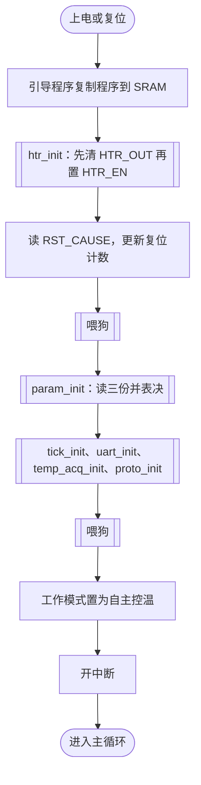
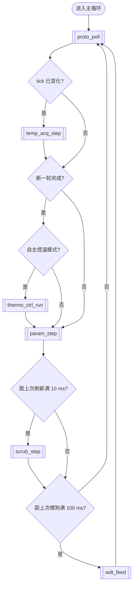

# 热控单元软件概要设计说明（参考）

## 1 范围

### 1.1 标识

软件名称：热控单元软件；软件简称：TCUS；版本：V1.0；目标平台：BM3803（SPARC V8，大端）；编程语言：C89；裸机运行，不使用操作系统。

### 1.2 系统概述

热控单元采集 32 路测温点温度，控制 16 路加热器，经一路 RS422 异步串口接收平台的遥控指令和控温参数上注，应答遥测查询（TCUS-SRS-001 1.2）。

### 1.3 文档概述

本文档是 TCUS 的概要设计，正向设计。内容包括 CSCI 级设计决策、模块划分和需求分配、执行方案和时序分析、接口、数据、资源余量、可靠性和安全性设计、需求追溯和待确认问题。各模块的函数级设计另见各模块的详细设计说明。

## 2 引用文档

| 编号 | 名称 | 版本 |
|---|---|---|
| TCUS-SRS-001（SRS） | 热控单元软件需求规格说明 | V1.0 |
| TCU-HW-ICD-001（HW） | 热控单元硬件接口说明 | V1.0 |
| TCU-PLT-ICD-002（PLT） | 热控单元与平台通信协议 | V1.1 |

## 3 设计依据

### 3.1 需求

| 需求标识 | 原文 |
|---|---|
| TCUS-MOD-001 | 上电或复位后，软件应在 2 s 内完成初始化并进入自主控温模式。初始化完成前，所有加热器应处于断开状态。 |
| TCUS-MOD-002 | 软件有自主控温模式和遥控模式两种工作模式。自主控温模式下，软件按控温参数自动控制加热器；遥控模式下，软件不进行自主控温，加热器只按遥控指令接通或断开。工作模式由遥控指令切换。 |
| TCUS-FUN-001 | 软件应每 1 s 完成一轮 32 路测温点 T1～T32 的采集。每路连续采样 4 次，去掉最大值和最小值，取其余 2 次的平均值作为该路本轮的测量值（ADC 原码）。 |
| TCUS-FUN-002 | 测量值小于 0x010 或大于 0xFEF 时，判该测温点故障，置该路的测温点故障标志；测量值恢复到上述范围以内时，清除故障标志。 |
| TCUS-FUN-010 | 自主控温模式下，软件每 1 s 对加热器 H1～H16 各进行一次控温：控温点温度低于下限阈值时接通该路加热器，高于上限阈值时断开，介于两者之间时保持不变。每路加热器的控温点编号（1～32）和上、下限阈值由控温参数表规定（见 TCUS-DAT-001）。 |
| TCUS-FUN-011 | 控温点故障时，对应的加热器应进行故障处理。 |
| TCUS-FUN-020 | 软件应接收平台发送的遥控帧，执行以下指令：加热器接通（指定一路）、加热器断开（指定一路）、加热器全部断开、切换到自主控温模式、切换到遥控模式。帧格式和指令码见 TCU-PLT-ICD-002。 |
| TCUS-FUN-021 | 帧校验错误、长度错误、指令码或参数非法的遥控帧应丢弃，遥控错误计数加 1。正确接收的遥控帧，遥控接收计数加 1。 |
| TCUS-FUN-022 | 加热器接通、断开指令只在遥控模式下执行；自主控温模式下收到时拒绝执行，遥控拒绝计数加 1。“加热器全部断开”指令在两种模式下都执行。 |
| TCUS-PER-001 | 从遥控帧最后一个字节接收完毕到指令执行完毕（加热器输出改变）的时间应不大于 10 ms。 |
| TCUS-FUN-025 | 软件应接收平台发送的参数上注帧，用帧中的控温参数表替换当前使用的控温参数，并在 1 s 内完成 EEPROM 中三份控温参数的存储。参数非法（控温点编号不在 1～32 范围内，或下限阈值不小于上限阈值）的上注帧应拒绝，遥控拒绝计数加 1。 |
| TCUS-FUN-030 | 平台每 500 ms 发送一次遥测查询帧。软件收到正确的遥测查询帧后，应在 5 ms 内开始发送遥测应答帧。 |
| TCUS-FUN-031 | 遥测应答帧的内容包括：32 路测温点最近一轮的测量值、16 路加热器状态、当前工作模式、遥控接收计数、遥控错误计数、遥控拒绝计数、32 路测温点故障标志、复位计数。 |
| TCUS-INT-001 | 软件与平台之间采用 RS422 异步串行通信：波特率 115200 bps，8 位数据位，1 位停止位，无校验。帧格式见 TCU-PLT-ICD-002。 |
| TCUS-INT-002 | 测温、加热器、看门狗、EEPROM 等硬件接口见 TCU-HW-ICD-001。 |
| TCUS-DAT-001 | 控温参数表包括 16 路加热器各自的控温点编号（1 字节，1～32）、下限阈值和上限阈值（各 2 字节，ADC 原码），共 80 字节。控温参数表在 EEPROM 中存储三份。上电时读取三份，按字节三取二表决后使用；三份互不相同的字节，使用默认控温参数表中对应的字节。 |
| TCUS-DAT-002 | 遥控接收计数、遥控错误计数、遥控拒绝计数、复位计数均为 8 位，计到 255 后从 0 重新计数。 |
| TCUS-SAF-001 | 任何时刻同时接通的加热器不得超过 8 路。 |
| TCUS-SAF-002 | 软件复位（包括看门狗复位）后，在恢复控温之前，所有加热器应保持断开。 |
| TCUS-RES-001 | CPU 负荷应不大于 50%（设计阶段按最坏情况估算，系统测试时实测）。 |
| TCUS-RES-002 | 程序存储器（PROM）和数据存储器（SRAM）的使用量均应留有不少于 20% 的余量。 |
| TCUS-REL-001 | 软件应使用看门狗。喂狗只能在主程序中进行，不得在中断服务程序中喂狗。 |
| TCUS-REL-002 | 软件应周期刷新 SRAM（读出后写回），每 60 s 内完成一遍全部 SRAM 的刷新。 |
| TCUS-CON-001 | 软件使用 C 语言（C89）编写，裸机运行，不使用操作系统。 |
| TCUS-CON-002 | 访问在中断服务程序和主程序之间共享的数据时，应采取关中断等保护措施。 |

### 3.2 硬件和接口约束

| 条款 | 原文 |
|---|---|
| HW-1.1 | 处理器为 BM3803（SPARC V8），主频 50 MHz，大端字节序。 |
| HW-1.2 | 存储器映射：PROM 0x00000000～0x0007FFFF，512 KB，程序存储，上电后由引导程序把程序复制到 SRAM 运行；SRAM 0x40000000～0x400FFFFF，1 MB，程序运行区和数据区，有 EDAC 保护；EEPROM 0x10000000～0x10007FFF，32 KB；FPGA 寄存器 0x20000000～0x200000FF。 |
| HW-1.3 | SRAM 的 EDAC：读出时发现单位错误，由硬件纠正后送给处理器，但存储器中的错误数据不会被改写；发现双位错误时产生不可屏蔽中断（IRL 15）。 |
| HW-1.4 | SRAM 读、写一个 32 位字各需 4 个时钟周期。 |
| HW-2.1 | BM3803 的中断级别为 1～15，15 级最高且不可屏蔽。处理器进入中断服务程序时自动关闭中断；中断服务程序中是否允许更高级别的中断打断，由软件决定。 |
| HW-2.2 | 中断分配：定时器 1，8 级；RS422 UART，5 级，接收中断和发送中断共用，原因见 UART_STAT；EDAC 双位错误，15 级，不可屏蔽。 |
| HW-3.1 | UART_DATA（0x20000000）读：从接收 FIFO 取出一个字节，写：写入发送 FIFO 一个字节；UART_STAT（0x20000004）bit4～0 RX_CNT，bit12～8 TX_CNT，bit16 RX_OVR（写 1 清除），bit17 RX_IRQ、bit18 TX_IRQ；UART_CTRL（0x20000008）bit3～0 RX_TRIG（1～15），bit8 RX_IE，bit9 TX_IE，bit12～11 PARITY；UART_BAUD（0x2000000C）分频值 = 50 MHz ÷（16 × 波特率）− 1，取整。 |
| HW-3.2 | 接收 FIFO、发送 FIFO 深度各为 16 字节。接收 FIFO 满后再收到的字节被丢弃，并置 RX_OVR。 |
| HW-3.3 | 接收中断：接收 FIFO 中的字节数达到 RX_TRIG，或接收 FIFO 非空且连续 4 个字符时间没有收到新字节时产生。发送中断：TX_IE = 1 且发送 FIFO 中的字节数不大于 4 时产生。 |
| HW-3.4 | 数据格式为 1 位起始位、8 位数据位、可选校验位、1 位停止位。 |
| HW-4.1 | 32 路热敏电阻经多路开关接入一个 12 位 ADC。向 MUX_SEL（0x20000020）写 0～31 选择通道，写入值 n − 1 对应测温点 Tn。 |
| HW-4.2 | 切换通道后，须等待不少于 1 ms（输入滤波电路稳定时间）再启动转换。 |
| HW-4.3 | 向 ADC_CTRL（0x20000024）写 1 启动一次转换，转换时间不大于 20 μs。转换完成后 ADC_STAT（0x20000028）bit0 为 1，ADC_DATA（0x2000002C）bit11～0 为转换结果；读 ADC_DATA 后 ADC_STAT bit0 清零。 |
| HW-4.4 | 热敏电阻为负温度系数：温度升高时 ADC 原码减小。−40 ℃ 时原码约为 0xF00，+60 ℃ 时约为 0x100。 |
| HW-5.1 | HTR_OUT（0x20000040）bit n − 1 对应加热器 Hn（n = 1～16），写 1 接通，写 0 断开；读出值为写入值。 |
| HW-5.2 | HTR_EN（0x20000044）bit0：0 表示全部加热器断开（与 HTR_OUT 的内容无关），1 表示按 HTR_OUT 输出。复位后 HTR_EN 为 0，HTR_OUT 的内容不确定。 |
| HW-5.3 | 每路加热器功率 10 W，加热器电源最大输出功率 80 W。 |
| HW-6.1 | 看门狗上电后即开始工作，不能关闭。超时时间为 800 ms ± 10%。 |
| HW-6.2 | 喂狗方法：向 WDT_FEED（0x20000060）先写 0x55，再写 0xAA，两次写入之间不超过 10 μs。 |
| HW-6.3 | 看门狗超时后复位处理器和 FPGA，FPGA 寄存器恢复为复位值。RST_CAUSE（0x20000064）bit0 为 1 表示上电复位，bit1 为 1 表示看门狗复位，写 1 清除。 |
| HW-7.1 | EEPROM 容量 32 KB，按字节读写，读访问时间 200 ns。 |
| HW-7.2 | 写入采用页写方式，每页 64 字节（按 64 字节对齐）。写入一页后进入写周期，写周期最长 10 ms，期间 EE_STAT（0x20000070）bit0（BUSY）为 1，不能读写 EEPROM。 |
| HW-7.3 | 控温参数存储区（EEPROM 内的偏移地址）：第一份 0x0000～0x00FF，第二份 0x0100～0x01FF，第三份 0x0200～0x02FF。 |
| HW-8.1 | BM3803 片内定时器 1 经预分频后计数时钟为 1 MHz，定时周期 =（重装值 + 1）μs，重装值 0～65535。定时到时产生 8 级中断并自动重装。 |
| PLT-1.1 | RS422 异步串行通信，波特率 57600 bps，8 位数据位，1 位停止位，无校验。 |
| PLT-1.2 | 平台是通信的发起方。平台发送的相邻两帧之间间隔不小于 20 ms。 |
| PLT-2.1 | 帧格式：帧头 2 字节（0xEB、0x90）、帧类型 1 字节、数据长度 1 字节（N）、数据 N 字节、校验 2 字节（CRC-16/CCITT，多项式 0x1021，初值 0xFFFF，计算范围从帧类型到数据末尾）。 |
| PLT-2.2 | 多字节数据高字节在前。 |
| PLT-2.3 | 帧类型：0x01 遥控帧，N = 2；0x02 遥测查询帧，N = 0；0x03 参数上注帧，N = 80；0x81 遥测应答帧，N = 72。 |
| PLT-3.1 | 遥控帧数据为指令码和参数：0x11 加热器接通（1～16）；0x12 加热器断开（1～16）；0x13 加热器全部断开（0x00）；0x21 切换到自主控温模式（0x00）；0x22 切换到遥控模式（0x00）。 |
| PLT-4.1 | 参数上注帧数据为 16 组控温参数，按 H1～H16 的顺序排列，每组 5 字节：控温点编号（1 字节）、下限阈值（2 字节）、上限阈值（2 字节）。 |
| PLT-5.1 | 遥测应答帧数据共 72 字节：偏移 0 起 64 字节 T1～T32 测量值；64 起 2 字节加热器状态；66 工作模式；67 遥控接收计数；68 遥控错误计数；69 遥控拒绝计数；70 复位计数；71 备用，填 0x00。 |
| PLT-5.2 | 平台发出遥测查询帧后等待 20 ms，20 ms 内没有收到应答帧的第一个字节时，判为应答超时。 |

## 4 CSCI 级设计决策

| 编号 | 决策 | 理由 | 影响 |
|---|---|---|---|
| D-001 | 前后台结构：主循环连续运行（不定周期），每轮处理协议并按 tick 调度各周期任务；中断只做数据搬移和计数 | TCUS-CON-001 不使用操作系统；最严的响应要求为 5 ms（TCUS-FUN-030），主循环一轮要远小于它 | 所有任务都不能阻塞主循环 |
| D-002 | 时基 tick 为 1 ms，由定时器 1 产生（重装值 999，HW-8.1） | 测温稳定时间 1 ms（HW-4.2）、喂狗、各周期任务都按 tick 计时 | tick 计数为 32 位，约 49.7 天回绕，时间差按无符号相减 |
| D-003 | 中断不嵌套：中断服务程序中不重新开中断（EDAC 双位错误为不可屏蔽中断，除外） | 两个可屏蔽中断的最长执行时间分别为 5 μs 和 30 μs（6.3，估计），不嵌套时定时中断的最大延迟远小于 1 ms，不会丢 tick；栈深度易于估计 | 中断服务程序的最长执行时间要控制在 6.3 的预算内 |
| D-004 | RS422 收发都用中断：接收门限 RX_TRIG = 8，并利用接收超时中断取帧尾；发送用发送中断续写。接收、发送环形缓冲区各 256 字节 | 接收 FIFO 只有 16 字节（HW-3.2），最长的平台帧 86 字节，查询方式要求主循环的服务间隔小于 FIFO 填满的时间；遥测应答帧 78 字节，超过发送 FIFO | 环形缓冲区是中断和主循环的共享数据（6.5） |
| D-005 | 分步执行：主循环中每个任务每次调用的执行时间不超过 0.5 ms，忙等不超过 50 μs。测温、EEPROM 写入、SRAM 刷新都做成按 tick 推进的分步状态机 | 一轮测温如果连续执行需要 32 ×（1 ms + 4 × 20 μs），EEPROM 三份共 6 页、每页写周期最长 10 ms，连续执行都会超过 5 ms 的响应要求 | 各模块的详细设计要按此预算实现 |
| D-006 | 加热器输出只由 htr_out 写 HTR_OUT、HTR_EN；同时接通数量的限制在 htr_out 中检查 | 自主控温、遥控、全部断开、故障处理多条路径都要满足 TCUS-SAF-001，统一在唯一出口检查 | thermo_ctrl、tc_exec 不直接访问加热器寄存器 |
| D-007 | 测温数据双缓冲：采集过程写工作缓冲区，一轮 32 路完成后整体复制到发布缓冲区；控温和遥测只读发布缓冲区 | 一轮采集分散在约 64 ms 内完成，遥测应下传完整一轮的结果（TCUS-FUN-031“最近一轮的测量值”） | 复制在主循环中进行，与读者同在主循环，不需要关中断 |
| D-008 | 喂狗：主循环中每 100 ms 喂一次（按 tick 计时）；初始化过程中各步骤之间喂狗；两次写入在关中断内连续完成 | 看门狗最短超时 720 ms（HW-6.1 的下限），喂狗间隔取其一半以下并留余量；HW-6.2 要求两次写入之间不超过 10 μs，中间不能被中断打断 | 主循环停止运行时看门狗复位 |
| D-009 | 共享数据保护：环形缓冲区按单写者单读者设计，读下标、写下标各只由一方修改，均为 32 位对齐的 volatile 变量；其他共享变量在主循环中访问时关中断，单次关中断不超过 10 μs | 满足 TCUS-CON-002，同时避免长时间关中断 | 不可屏蔽中断（EDAC）写的数据不能用关中断保护，单独处理（6.5） |
| D-010 | SRAM 刷新：每 10 ms 刷新 1 KB，每个字的读出和写回在关中断内完成；EDAC 记录所在的字不刷新 | 1 MB 分 1024 次，一遍约 10.24 s，满足 60 s（TCUS-REL-002）；读出和写回之间被中断修改会丢失中断写入的值 | mem_mon 每 10 ms 调用一次 |
| D-011 | 栈 16 KB，放在 SRAM 高端 | 调用深度浅、中断不嵌套，按 4 倍余量 | 计入 SRAM 资源（第 9 章） |
| D-012 | 参数存储顺序：依次写第一份、第二份、第三份，每份写完回读校验后再写下一份 | 写入过程中复位时，至多一份不完整，上电三取二仍能得到正确参数 | 存储时间按 6 页计算（6.4） |
| D-013 | 编码规范按 GJB 8114 | 部门规定 | 无 |

## 5 体系结构设计

### 5.1 运行环境

处理器 BM3803，主频 50 MHz，大端（HW-1.1）。程序存放在 PROM，由引导程序复制到 SRAM 运行（HW-1.2）。外设：RS422 UART（HW-3.1）、测温多路开关和 ADC（HW-4.1）、加热器输出（HW-5.1）、看门狗（HW-6.1）、EEPROM（HW-7.1）、定时器 1（HW-8.1）。使用的中断见 6.3。

### 5.2 软件模块

| 模块 | 标识 | 职责 | 执行环境 | 分配的需求 |
|---|---|---|---|---|
| 主程序和调度 | `sched` | 上电初始化顺序；主循环和任务调度；喂狗；读取复位原因、维护复位计数 | 初始化、主循环 | TCUS-MOD-001、TCUS-SAF-002、TCUS-REL-001、TCUS-RES-001、TCUS-RES-002、TCUS-CON-001、TCUS-DAT-002、TCUS-INT-002 |
| 时基 | `tick` | 定时器 1 初始化，1 ms 定时中断，tick 计数 | 初始化、中断（8 级） | D-002、TCUS-CON-002 |
| RS422 驱动 | `uart_drv` | UART 初始化；接收、发送中断；接收、发送环形缓冲区 | 初始化、主循环、中断（5 级） | TCUS-INT-001、TCUS-CON-002 |
| 协议处理 | `plt_proto` | 从接收缓冲区找帧、检查帧头、长度、帧类型和 CRC；按帧类型分发；遥控接收计数和错误计数 | 主循环 | TCUS-FUN-020、TCUS-FUN-021、TCUS-PER-001、TCUS-FUN-030、TCUS-DAT-002 |
| 遥控执行 | `tc_exec` | 遥控指令的合法性和模式检查、执行；工作模式；遥控拒绝计数 | 主循环 | TCUS-MOD-002、TCUS-FUN-020、TCUS-FUN-022、TCUS-PER-001、TCUS-DAT-002 |
| 测温采集 | `temp_acq` | 分步采集 32 路，每路 4 次去极值平均；故障判定；发布缓冲区 | 主循环 | TCUS-FUN-001、TCUS-FUN-002、TCUS-INT-002 |
| 自主控温 | `thermo_ctrl` | 每轮测温完成后按控温参数决定各路加热器的通断；控温点故障时的处理 | 主循环 | TCUS-MOD-002、TCUS-FUN-010、TCUS-FUN-011 |
| 加热器输出 | `htr_out` | 加热器寄存器的唯一访问者；上电断开；同时接通数量限制；全部断开 | 初始化、主循环 | TCUS-MOD-001、TCUS-SAF-001、TCUS-SAF-002、TCUS-FUN-022、TCUS-INT-002 |
| 参数管理 | `param` | 上电读取三份参数并表决；默认参数；上注参数检查；分步写入三份参数 | 初始化、主循环 | TCUS-DAT-001、TCUS-FUN-025、TCUS-INT-002 |
| 遥测 | `tm_proc` | 收到查询帧后组遥测应答帧并启动发送 | 主循环 | TCUS-FUN-030、TCUS-FUN-031 |
| 存储器监视 | `mem_mon` | SRAM 分步刷新；EDAC 双位错误中断处理 | 主循环、中断（15 级） | TCUS-REL-002 |

### 5.3 模块关系

| 调用者 | 被调用模块 | 接口 |
|---|---|---|
| sched（初始化） | htr_out、param、tick、uart_drv、temp_acq、plt_proto | htr_init、param_init、tick_init、uart_init、temp_acq_init、proto_init |
| sched（主循环） | plt_proto、temp_acq、thermo_ctrl、param、mem_mon、tick | proto_poll、temp_acq_step、temp_acq_round、thermo_ctrl_run、param_step、scrub_step、tick_now |
| plt_proto | uart_drv、tc_exec、param、tm_proc | uart_read、tc_exec_cmd、param_upload、tm_on_query |
| tc_exec | htr_out | htr_set、htr_all_off |
| thermo_ctrl | temp_acq、param、htr_out、tc_exec | temp_acq_latest、param_get、htr_set、tc_mode |
| param | tc_exec | tc_reject_inc |
| tm_proc | temp_acq、htr_out、tc_exec、plt_proto、sched、uart_drv | temp_acq_latest、htr_state、tc_mode、tc_reject_count、proto_counts、sched_reset_count、uart_write |

模块多于 6 个，关系用表格表示。中断处理程序 tick_isr、uart_isr、edac_isr 不调用其他模块的接口。

## 6 执行方案

### 6.1 启动和初始化

图 6-1 启动和初始化流程

1. 复位后 HTR_EN 为 0，全部加热器断开（HW-5.2）。htr_init 先写 HTR_OUT = 0，再写 HTR_EN = 1，保证使能时输出仍为全部断开（TCUS-SAF-002）。
2. 进入主循环时工作模式为自主控温（TCUS-MOD-001）；第一轮测温完成之前 thermo_ctrl 不运行，加热器保持断开（TCUS-SAF-002）。
3. 初始化总时间和喂狗间隔的分析见 TA-06、TA-08。
4. 复位计数的保存位置【待确认】（见 Q-006）。

### 6.2 主循环和任务调度

| 任务 | 所属模块 | 触发 | 周期 | 最长执行时间 | 说明 |
|---|---|---|---|---|---|
| proto_poll | plt_proto | 每轮 | 连续 | 0.1 ms（估计：解析一帧 86 字节并计算 CRC） | PLT-1.2 规定帧间隔不小于 20 ms，一轮内至多处理一帧完整的帧 |
| tm_on_query | tm_proc | 收到查询帧时由 proto_poll 调用 | 500 ms | 0.1 ms（估计：组 78 字节应答帧并计算 CRC） | 计入 proto_poll 所在的一轮 |
| temp_acq_step | temp_acq | tick 变化时 | 1 ms | 0.12 ms（估计：4 次转换各不大于 20 μs，HW-4.3，加处理开销） | 每次只做“切换通道”或“转换 4 次”中的一步 |
| thermo_ctrl_run | thermo_ctrl | 新一轮测温完成且为自主控温模式 | 1 s | 0.05 ms（估计：16 路比较） | |
| param_step | param | 每轮（存储进行中时） | — | 0.05 ms（估计：写一页 64 字节） | 写周期内只查询 BUSY，不等待 |
| scrub_step | mem_mon | 距上次不少于 10 ms | 10 ms | 0.13 ms（估计：256 字，每字 25 个时钟周期） | D-010 |
| wdt_feed | sched | 距上次不少于 100 ms | 100 ms | 1 μs（估计） | D-008 |

主循环最长一轮：上述任务在同一轮中都到期时，约 0.1 + 0.1 + 0.12 + 0.05 + 0.05 + 0.13 + 0.001 ≈ 0.55 ms，按 0.6 ms 计（估计，待实测）。

图 6-2 主循环流程

测温的分步方式：每路分两步，第一步写 MUX_SEL 并记下当时的 tick；第二步在 tick 前进 2 以后才执行，启动并读取 4 次转换。用 tick 计时时起点落在两个 tick 之间，前进 2 个 tick 才能保证不少于 1 ms（HW-4.2）。一轮 32 路完成后复制到发布缓冲区（D-007），下一轮在距本轮开始满 1 s 时开始（TCUS-FUN-001）。

### 6.3 中断

| 中断源 | 级别 | 处理程序 | 处理内容 | 最长执行时间 | 嵌套 |
|---|---|---|---|---|---|
| 定时器 1 | 8 | `tick_isr` | tick 计数加 1 | 5 μs（估计） | 不嵌套（D-003） |
| RS422 UART | 5 | `uart_isr` | 接收：把接收 FIFO 中的字节全部搬到接收缓冲区；RX_OVR 为 1 时写 1 清除并计数。发送：从发送缓冲区续写发送 FIFO，发送缓冲区空时清 TX_IE | 30 μs（估计：最多搬移 16 字节） | 不嵌套（D-003） |
| EDAC 双位错误 | 15 | `edac_isr` | 记录错误次数和最近一次的错误地址；其他处理【待确认】（见 Q-008） | 10 μs（估计） | 不可屏蔽，可打断其他中断和关中断区 |

可屏蔽中断的最长响应延迟：另一个可屏蔽中断的处理时间（30 μs）加主循环中最长的关中断时间（10 μs，D-009），约 40 μs（估计）。

### 6.4 时序分析

| 编号 | 依据 | 时间要求 | 最坏情况路径 | 最坏情况时间 | 结论 |
|---|---|---|---|---|---|
| TA-01 | TCUS-PER-001、HW-3.3、PLT-1.2 | 不大于 10 ms | 帧尾字节到达 → 接收超时中断 → uart_isr → 等待主循环最长一轮 → proto_poll 解析 → tc_exec 执行 → htr_out 写寄存器 | 约 1.5 ms（估计） | 满足（估计，待实测） |
| TA-02 | TCUS-FUN-030、PLT-5.2 | 5 ms 内开始发送 | 查询帧尾到达 → 接收超时中断 → uart_isr → 等待主循环最长一轮 → proto_poll → tm_on_query 组帧 → 写入发送 FIFO | 约 1.5 ms（估计） | 满足（估计，待实测） |
| TA-03 | TCUS-FUN-001、HW-4.2、HW-4.3 | 每 1 s 完成一轮 | 32 路 × 每路 2 个 tick，每步可能被主循环延迟一轮 | 约 83 ms（估计） | 满足（估计，待实测） |
| TA-04 | TCUS-FUN-010 | 每 1 s 控温一次 | 每轮测温完成后执行一次，测温轮次按 1000 ms 计时启动 | 周期 1 s，抖动约 20 ms（估计） | 满足（估计，待实测） |
| TA-05 | HW-4.2 | 不少于 1 ms | 切换通道后等 tick 前进 2，由计时方式保证 | 不少于 1 ms | 满足 |
| TA-06 | TCUS-REL-001、HW-6.1、TCUS-MOD-001 | 喂狗间隔小于 720 ms | 主循环中：100 ms 加主循环最长一轮；上电后：引导程序复制加初始化 | 约 101 ms（估计） | 满足（估计，待实测） |
| TA-07 | TCUS-FUN-025、HW-7.2 | 1 s 内完成 | 6 页，每页写入后等写周期结束，每页另加主循环最长一轮 | 约 64 ms（估计） | 满足（估计，待实测） |
| TA-08 | TCUS-MOD-001、HW-7.1 | 2 s 内进入自主控温模式 | 引导程序复制程序 + 初始化（含读三份参数） | 约 40 ms（估计） | 满足（估计，待实测） |
| TA-09 | TCUS-REL-002、HW-1.4 | 60 s 内刷新一遍 | 1024 次 × 10 ms，每次可能延迟主循环最长一轮 | 约 10.9 s（估计） | 满足（估计，待实测） |
| TA-10 | HW-3.2、HW-3.3 | 接收 FIFO 不溢出：0.69 ms 内服务 | 门限 8 字节触发中断后，FIFO 余下 8 字节的空间；中断响应延迟 | 约 40 μs（估计） | 满足（估计，待实测） |
| TA-11 | HW-6.2 | 两次写入之间不超过 10 μs | 关中断内连续两次写寄存器（EDAC 不可屏蔽中断除外） | 约 20 μs（估计，被 EDAC 中断打断时） | 不满足 |

TA-01：E（接收超时，4 个字符时间）= 4 × 10 ÷ 115200 ≈ 0.35 ms，按 PLT-1.1 的 57600 bps 计为 0.69 ms（见 Q-001），取 0.69 ms；uart_isr 30 μs；W（主循环最长一轮）0.6 ms；P（解析、执行、写 HTR_OUT）约 0.1 ms；期间定时中断 1～2 次，约 10 μs。合计约 1.43 ms，取 1.5 ms。PLT-1.2 规定帧间隔不小于 20 ms，处理期间不会有第二帧到达。

TA-02：遥测查询帧只有 6 字节，低于接收门限 8，帧尾靠接收超时中断取出，E 同 TA-01；P 为组帧和写入第一批 16 字节，约 0.1 ms。合计约 1.5 ms，也满足平台 20 ms 的等待（PLT-5.2）。应答帧 78 字节的传输时间：115200 bps 下约 6.8 ms，57600 bps 下约 13.5 ms，后续字节由发送中断续写。

TA-03：每路第一步切换通道，第二步在 tick 前进 2 后执行，每路约 2 ms，每步最多再延迟一轮主循环 0.6 ms，32 ×（2 + 2 × 0.3）约 83 ms，远小于 1 s。

TA-04：测温轮次按 tick 每 1000 ms 启动一次，控温在本轮完成后执行；一轮的完成时刻在 64～83 ms 之间变化，因此控温周期为 1 s，抖动约 20 ms（估计）。

TA-06：主循环中最坏喂狗间隔 = 100 ms + 0.6 ms ≈ 101 ms，小于 720 ms 的一半。上电到第一次喂狗：引导程序复制程序约 20 ms（估计：程序约 64 KB），htr_init 和读复位原因不到 1 ms，之后立即喂狗。

TA-07：每份 80 字节占 2 页（偏移 0x00～0x3F、0x40～0x4F），三份共 6 页（HW-7.3）。每页：写入约 0.05 ms，写周期最长 10 ms，查询到 BUSY 为 0 最多再延迟一轮 0.6 ms，6 × 10.65 ≈ 64 ms。

TA-08：读三份参数共 240 字节，每字节 200 ns（HW-7.1），约 48 μs；初始化其余部分约 1 ms（估计）；加引导程序复制 20 ms，按 40 ms 计。

TA-09：每次刷新 1 KB（256 字），每字读写 8 个时钟周期（HW-1.4）加关中断和循环开销约 17 个周期，256 × 25 × 20 ns ≈ 0.13 ms；1024 次，每次间隔 10 ms 加最多 0.6 ms 延迟，约 10.9 s。

TA-10：RX_TRIG = 8 时，触发中断后 FIFO 还能再收 8 字节，115200 bps 下 8 × 86.8 μs ≈ 0.69 ms（57600 bps 下 1.39 ms）；中断响应延迟约 40 μs（6.3），满足。

TA-11：两次写入在关中断内连续执行，正常情况下间隔不到 1 μs；但 EDAC 双位错误中断不可屏蔽，若恰好发生在两次写入之间，间隔为 edac_isr 的执行时间（约 10 μs）加中断进出开销，可能超过 10 μs，这次喂狗无效。由于下一次喂狗在 100 ms 后，看门狗最短 720 ms 才超时，一次喂狗无效不会导致复位；同时双位错误本身的处理【待确认】（见 Q-008）。此项按“不满足，影响可接受”处理，需在 Q-008 答复时一并确认。

### 6.5 共享数据

| 数据 | 写者 | 读者 | 保护 |
|---|---|---|---|
| 接收缓冲区内容和写下标 | uart_isr（中断） | uart_read（主循环） | 单写者单读者：写下标只由 uart_isr 修改，读下标只由 uart_read 修改；下标为 32 位对齐的 volatile 变量（D-009） |
| 接收缓冲区读下标 | uart_read（主循环） | uart_isr（判断缓冲区满） | 同上 |
| 发送缓冲区内容和写下标 | uart_write（主循环） | uart_isr（中断） | 单写者单读者；uart_write 写完数据后再更新写下标，置 TX_IE 的读-改-写在关中断内完成（不超过 5 μs，估计） |
| 发送缓冲区读下标 | uart_isr（中断） | uart_write（主循环，判断剩余空间） | 单写者单读者，32 位对齐 volatile |
| 接收溢出次数 | uart_isr（中断） | 无（保留供调试） | 32 位对齐字，只由中断写 |
| tick 计数 | tick_isr（中断） | tick_now（主循环） | 32 位对齐字，读写是原子的，volatile |
| EDAC 错误次数、错误地址 | edac_isr（不可屏蔽中断） | mem_mon（主循环） | 不能用关中断保护：先读次数、再读地址、再读次数，两次次数相同时读到的地址有效；这两个字不参加 SRAM 刷新（D-010） |

其余数据只在主循环中访问，不需要保护。

## 7 接口设计

### 7.1 外部接口

| 接口 | 对端 | 依据 | 实现模块 | 说明 |
|---|---|---|---|---|
| RS422 遥控遥测 | 平台数管计算机 | TCUS-INT-001、PLT-1.1～5.2 | uart_drv、plt_proto、tm_proc | 波特率【待确认】（见 Q-001），暂按 SRS 设计（Q-001 确认前）；遥测内容【待确认】（见 Q-002） |
| 测温 | 多路开关和 ADC | HW-4.1～4.4 | temp_acq | |
| 加热器 | 加热器驱动电路 | HW-5.1～5.3 | htr_out | |
| 看门狗、复位原因 | FPGA | HW-6.1～6.3 | sched | |
| EEPROM | EEPROM | HW-7.1～7.3 | param | |
| 定时器 1 | BM3803 片内 | HW-8.1 | tick | |
| EDAC | BM3803 存储器控制器 | HW-1.3 | mem_mon | |

### 7.2 模块接口

#### 7.2.1 sched（主程序和调度）

| 接口 | 调用者 | 执行环境 | 说明 |
|---|---|---|---|
| `int main(void)` | 引导程序 | 初始化、主循环 | 按 6.1 初始化后进入主循环，不返回 |
| `uint8_t sched_reset_count(void)` | tm_proc | 主循环 | 返回复位计数（8 位，回绕，TCUS-DAT-002） |

使用的接口：各模块的初始化接口和周期接口（5.3）；WDT_FEED、RST_CAUSE（HW-6.2、HW-6.3）。

#### 7.2.2 tick（时基）

| 接口 | 调用者 | 执行环境 | 说明 |
|---|---|---|---|
| `void tick_init(void)` | sched | 初始化 | 定时器 1 重装值 999（D-002），使能中断 |
| `uint32_t tick_now(void)` | 各模块 | 主循环 | 返回 tick 计数，单位 1 ms，32 位回绕；时间差按无符号相减 |
| `void tick_isr(void)` | 定时器 1 中断 | 中断（8 级） | tick 计数加 1 |

使用的接口：定时器 1 寄存器（HW-8.1）。

#### 7.2.3 uart_drv（RS422 驱动）

| 接口 | 调用者 | 执行环境 | 说明 |
|---|---|---|---|
| `void uart_init(void)` | sched | 初始化 | 设置波特率（Q-001）、无校验、RX_TRIG = 8，使能接收中断 |
| `uint32_t uart_read(uint8_t *buf, uint32_t max)` | plt_proto | 主循环 | 从接收缓冲区取出至多 max 字节，返回取出的字节数；不可重入 |
| `int uart_write(const uint8_t *buf, uint32_t len)` | tm_proc | 主循环 | 发送缓冲区剩余空间不小于 len 时整帧放入并启动发送，返回 0；否则不放入，返回 −1；不可重入 |
| `void uart_isr(void)` | UART 中断 | 中断（5 级） | 接收搬移、发送续写，见 6.3 |

使用的接口：UART 寄存器（HW-3.1～3.4）。

#### 7.2.4 plt_proto（协议处理）

| 接口 | 调用者 | 执行环境 | 说明 |
|---|---|---|---|
| `void proto_init(void)` | sched | 初始化 | 清找帧状态和计数 |
| `void proto_poll(void)` | sched | 主循环 | 取出接收缓冲区中的字节，按 PLT-2.1 找帧并检查；正确的遥控帧调用 tc_exec_cmd，查询帧调用 tm_on_query，上注帧调用 param_upload；按 TCUS-FUN-021 计数 |
| `void proto_counts(uint8_t *rx_cnt, uint8_t *err_cnt)` | tm_proc | 主循环 | 读取遥控接收计数和错误计数（8 位，回绕） |

使用的接口：uart_read、tc_exec_cmd、param_upload、tm_on_query。

帧检查的顺序：帧头 → 帧类型 → 数据长度与帧类型相符（PLT-2.3）→ CRC。遥控帧的指令码和参数由 tc_exec 检查，非法时 tc_exec_cmd 返回错误，由 plt_proto 计入遥控错误计数（TCUS-FUN-021）。“遥控帧”是否包括查询帧和上注帧（即这两种帧出错时是否计入遥控错误计数）按 TCUS-FUN-021 的字面只指遥控帧，【待确认】（见 Q-010）。

#### 7.2.5 tc_exec（遥控执行）

| 接口 | 调用者 | 执行环境 | 说明 |
|---|---|---|---|
| `int tc_exec_cmd(uint8_t code, uint8_t arg)` | plt_proto | 主循环 | 检查指令码和参数（PLT-3.1），非法返回 TC_ERR_CODE；模式不允许时拒绝计数加 1，返回 TC_REJECT；否则执行，返回 TC_OK |
| `uint8_t tc_mode(void)` | thermo_ctrl、tm_proc | 主循环 | 返回当前工作模式（0x01 自主控温，0x02 遥控） |
| `void tc_reject_inc(void)` | param | 主循环 | 遥控拒绝计数加 1（8 位，回绕） |
| `uint8_t tc_reject_count(void)` | tm_proc | 主循环 | 返回遥控拒绝计数 |

使用的接口：htr_set、htr_all_off。模式切换时加热器的处理【待确认】（见 Q-007）；htr_set 因数量限制失败时的处理【待确认】（见 Q-004）。

#### 7.2.6 temp_acq（测温采集）

| 接口 | 调用者 | 执行环境 | 说明 |
|---|---|---|---|
| `void temp_acq_init(void)` | sched | 初始化 | 清缓冲区，发布缓冲区标记为“无有效数据” |
| `void temp_acq_step(void)` | sched | 主循环 | 按 6.2 推进一步，执行时间不超过 0.12 ms（估计） |
| `uint32_t temp_acq_round(void)` | sched | 主循环 | 返回已完成的轮数，sched 据此判断是否有新一轮 |
| `const temp_data_t *temp_acq_latest(void)` | thermo_ctrl、tm_proc | 主循环 | 返回发布缓冲区：32 路测量值、32 路故障标志 |

使用的接口：MUX_SEL、ADC_CTRL、ADC_STAT、ADC_DATA（HW-4.1～4.3）；tick_now。转换完成的查询设超时 50 μs（D-005），超时的处理【待确认】（见 Q-003）。

#### 7.2.7 thermo_ctrl（自主控温）

| 接口 | 调用者 | 执行环境 | 说明 |
|---|---|---|---|
| `void thermo_ctrl_run(void)` | sched | 主循环 | 自主控温模式下，按发布缓冲区和控温参数对 16 路各决定一次通断，调用 htr_set |

使用的接口：temp_acq_latest、param_get、htr_set、tc_mode。阈值与原码的比较方向【待确认】（见 Q-005）；控温点故障时的处理【待确认】（见 Q-003）。

#### 7.2.8 htr_out（加热器输出）

| 接口 | 调用者 | 执行环境 | 说明 |
|---|---|---|---|
| `void htr_init(void)` | sched | 初始化 | 先写 HTR_OUT = 0，再写 HTR_EN = 1（HW-5.2） |
| `int htr_set(uint8_t n, uint8_t on)` | tc_exec、thermo_ctrl | 主循环 | 接通或断开第 n 路（1～16）。接通会使接通路数超过 8 路时不接通，返回 HTR_ERR_LIMIT（TCUS-SAF-001，超限的处理见 Q-004）；n 非法返回 HTR_ERR_ID；成功返回 HTR_OK |
| `void htr_all_off(void)` | tc_exec | 主循环 | 一次写 HTR_OUT = 0 |
| `uint16_t htr_state(void)` | tm_proc | 主循环 | 返回 HTR_OUT 的读出值（HW-5.1），bit n − 1 对应 Hn |

使用的接口：HTR_OUT、HTR_EN（HW-5.1、HW-5.2）。

#### 7.2.9 param（参数管理）

| 接口 | 调用者 | 执行环境 | 说明 |
|---|---|---|---|
| `void param_init(void)` | sched | 初始化 | 读三份参数，按字节三取二，三份互不相同的字节用默认参数（TCUS-DAT-001） |
| `const param_t *param_get(void)` | thermo_ctrl | 主循环 | 返回当前控温参数表 |
| `int param_upload(const uint8_t *data, uint32_t len)` | plt_proto | 主循环 | 检查参数（TCUS-FUN-025，检查方向见 Q-005），非法时调用 tc_reject_inc 并返回 PARAM_ERR；合法时替换当前参数并启动存储，返回 PARAM_OK；存储进行中再次上注的处理【待确认】（见 Q-009） |
| `void param_step(void)` | sched | 主循环 | 推进一步存储：BUSY 为 1 时直接返回；否则写下一页或回读校验（D-012） |

使用的接口：EEPROM、EE_STAT（HW-7.1～7.3）；tc_reject_inc。

#### 7.2.10 tm_proc（遥测）

| 接口 | 调用者 | 执行环境 | 说明 |
|---|---|---|---|
| `void tm_on_query(void)` | plt_proto | 主循环 | 按 PLT-5.1 组遥测应答帧，调用 uart_write 发送；发送缓冲区不足时本次不应答 |

使用的接口：temp_acq_latest、htr_state、tc_mode、proto_counts、tc_reject_count、sched_reset_count、uart_write。测温点故障标志的下传【待确认】（见 Q-002）。

#### 7.2.11 mem_mon（存储器监视）

| 接口 | 调用者 | 执行环境 | 说明 |
|---|---|---|---|
| `void scrub_step(void)` | sched | 主循环 | 刷新下一个 1 KB（D-010） |
| `void edac_isr(void)` | EDAC 双位错误中断 | 中断（15 级） | 记录次数和地址，见 6.3 |

使用的接口：无（直接按地址访问 SRAM，HW-1.2）。

## 8 数据设计

### 8.1 关键数据

| 名称 | 内容 | 所属模块 | 存储位置 | 保护或冗余 |
|---|---|---|---|---|
| 控温参数表 | 16 组，每组控温点编号、下限阈值、上限阈值，共 80 字节 | param | SRAM 工作副本；EEPROM 三份（HW-7.3） | 三份存储，上电按字节三取二（TCUS-DAT-001）；写入顺序和回读校验见 D-012 |
| 默认控温参数表 | 同上 | param | PROM（随程序，复制到 SRAM） | 由 SRAM 刷新覆盖 |
| 测温发布缓冲区 | 32 路测量值、32 路故障标志、有效标记 | temp_acq | SRAM | 双缓冲（D-007） |
| 工作模式 | 0x01 / 0x02 | tc_exec | SRAM | 无 |
| 遥控接收计数、遥控错误计数 | 8 位，回绕 | plt_proto | SRAM | 无 |
| 遥控拒绝计数 | 8 位，回绕 | tc_exec | SRAM | 无 |
| 复位计数 | 8 位，回绕 | sched | 【待确认】（见 Q-006） | 【待确认】（见 Q-006） |
| 加热器状态 | 16 位 | htr_out | HTR_OUT 寄存器（读出值为写入值，HW-5.1） | 不另存副本 |

### 8.2 存储分配

| 区域 | 地址范围 | 用途 | 依据 |
|---|---|---|---|
| PROM | 0x00000000～0x0007FFFF | 程序映像（代码、常量、初值数据、默认控温参数表） | HW-1.2 |
| SRAM | 0x40000000～0x400FFFFF | 程序运行区、数据区；栈 16 KB 放在高端（D-011） | HW-1.2 |
| EEPROM | 0x10000000～0x10007FFF | 控温参数三份，偏移 0x0000～0x02FF（HW-7.3），其余不使用 | HW-1.2、HW-7.3 |
| FPGA 寄存器 | 0x20000000～0x200000FF | UART、测温、加热器、看门狗、EEPROM 状态 | HW-1.2 |

## 9 资源分配和余量

| 资源 | 容量 | 估计使用量 | 余量 | 要求 | 结论 | 估计方法 |
|---|---|---|---|---|---|---|
| CPU 负荷 | 100% | 4.4%（估计） | 95.6% | ≤ 50%（TCUS-RES-001） | 满足（估计，待实测） | 按每秒最坏情况：定时中断 1000 × 5 μs = 5 ms；接收中断按平台最密的帧间隔 20 ms、每帧 86 字节，每 8 字节一次，约 540 × 30 μs ≈ 16 ms；协议处理 50 帧 × 0.1 ms = 5 ms；测温 32 ×（0.12 + 0.01）ms ≈ 4.2 ms；SRAM 刷新 100 × 0.13 ms = 13 ms；其余约 1 ms；合计约 44 ms |
| 程序存储器（PROM） | 512 KB | 64 KB（估计） | 87.5% | ≥ 20%（TCUS-RES-002） | 满足（估计，待实测） | 11 个模块，参考同类单机软件的代码量按每模块 4 KB 估计，加 C 运行库和常量，按 64 KB 计 |
| 数据存储器（SRAM） | 1 MB | 96 KB（估计） | 90.6% | ≥ 20%（TCUS-RES-002） | 满足（估计，待实测） | 程序副本 64 KB + 数据约 16 KB（收发缓冲区各 256 字节、测温双缓冲、参数表等，按 4 倍余量）+ 栈 16 KB（D-011） |
| EEPROM 参数区 | 768 字节 | 240 字节 | 68.8% | 无要求 | 满足 | 三份 × 80 字节（TCUS-DAT-001、HW-7.3） |

## 10 可靠性和安全性设计

| 项目 | 措施 | 依据 | 实现模块 |
|---|---|---|---|
| 看门狗 | 主循环中每 100 ms 喂狗，初始化各步骤之间喂狗，两次写入在关中断内连续完成；不在中断中喂狗（D-008、TA-06、TA-11） | TCUS-REL-001、HW-6.1、HW-6.2 | sched |
| SRAM 刷新 | 每 10 ms 刷新 1 KB，一遍约 10.9 s；每字的读出和写回在关中断内完成；EDAC 记录不刷新（D-010、TA-09） | TCUS-REL-002、HW-1.3 | mem_mon |
| EDAC 双位错误 | 记录次数和地址；后续处理【待确认】（见 Q-008） | HW-1.3 | mem_mon |
| 参数三份存储 | 按顺序写三份，每份回读校验；上电三取二（D-012） | TCUS-DAT-001 | param |
| 加热器数量限制 | htr_out 唯一出口统一检查（D-006）；超限时的处理【待确认】（见 Q-004） | TCUS-SAF-001、HW-5.3 | htr_out |
| 上电和复位 | 先清 HTR_OUT 再置 HTR_EN；第一轮测温完成前不控温（6.1） | TCUS-SAF-002、TCUS-MOD-001、HW-5.2 | htr_out、sched |
| 遥控指令防护 | 帧头、帧类型、长度、CRC 检查；指令码和参数检查；模式检查（7.2.4、7.2.5） | TCUS-FUN-021、TCUS-FUN-022 | plt_proto、tc_exec |
| 全部断开 | 两种模式下都执行，一次写 HTR_OUT = 0 | TCUS-FUN-022 | tc_exec、htr_out |
| 测温点故障 | 按 TCUS-FUN-002 判定和恢复；故障时加热器的处理【待确认】（见 Q-003） | TCUS-FUN-002、TCUS-FUN-011 | temp_acq、thermo_ctrl |
| 接收溢出 | uart_isr 清除 RX_OVR 并计数；溢出使当前帧不完整，按帧检查失败处理，plt_proto 重新找帧头 | HW-3.2 | uart_drv、plt_proto |
| 共享数据 | 见 6.5、D-009 | TCUS-CON-002 | uart_drv、tick、mem_mon |

## 11 需求追溯

| 需求标识 | 模块 | 说明 |
|---|---|---|
| TCUS-MOD-001 | sched、htr_out | 初始化顺序（6.1）、TA-08 |
| TCUS-MOD-002 | tc_exec、thermo_ctrl | 模式由 tc_exec 维护，自主控温由 thermo_ctrl 执行 |
| TCUS-FUN-001 | temp_acq | 分步采集（6.2）、TA-03 |
| TCUS-FUN-002 | temp_acq | 故障标志 |
| TCUS-FUN-010 | thermo_ctrl | TA-04；比较方向见 Q-005 |
| TCUS-FUN-011 | thermo_ctrl | 处理方式见 Q-003 |
| TCUS-FUN-020 | plt_proto、tc_exec | |
| TCUS-FUN-021 | plt_proto | 遥控接收计数和错误计数 |
| TCUS-FUN-022 | tc_exec、htr_out | |
| TCUS-PER-001 | plt_proto、tc_exec | TA-01 |
| TCUS-FUN-025 | param | TA-07；检查方向见 Q-005 |
| TCUS-FUN-030 | plt_proto、tm_proc | TA-02 |
| TCUS-FUN-031 | tm_proc | 故障标志见 Q-002 |
| TCUS-INT-001 | uart_drv | 波特率见 Q-001 |
| TCUS-INT-002 | temp_acq、htr_out、param、sched | |
| TCUS-DAT-001 | param | |
| TCUS-DAT-002 | plt_proto、tc_exec、sched | 各计数的所属模块见 8.1 |
| TCUS-SAF-001 | htr_out | D-006 |
| TCUS-SAF-002 | htr_out、sched | 6.1 |
| TCUS-RES-001 | sched | 第 9 章；各任务的执行时间预算见 6.2、6.3 |
| TCUS-RES-002 | sched | 第 9 章 |
| TCUS-REL-001 | sched | D-008 |
| TCUS-REL-002 | mem_mon | D-010 |
| TCUS-CON-001 | sched | 全部模块 C89 编写（D-013） |
| TCUS-CON-002 | uart_drv、tick | 6.5、D-009 |

## 12 待确认问题

| 编号 | 问题 | 依据（原文） | 影响 | 建议 |
|---|---|---|---|---|
| Q-001 | 波特率不一致 | SRS TCUS-INT-001：“波特率 115200 bps”；PLT-1.1：“波特率 57600 bps” | UART_BAUD 分频值（115200 bps 为 26，57600 bps 为 53）；FIFO 服务间隔和接收超时（TA-01、TA-02、TA-10 两种速率下均满足）；应答帧传输时间 6.8 ms 或 13.5 ms | 确认后修改 uart_init 的波特率常量，其他设计不变。暂按 SRS 设计（Q-001 确认前） |
| Q-002 | 遥测应答帧中没有测温点故障标志的位置 | SRS TCUS-FUN-031：遥测内容包括“32 路测温点故障标志”；PLT-5.1：72 字节中没有该项，只有 1 字节备用 | 32 路故障标志需要 4 字节，备用字节不够；按 PLT-5.1 组帧则 TCUS-FUN-031 的这一项不能下传 | 请总体确认：修改协议增加 4 字节，或修改 SRS（例如地面由测量值自行判断）。暂按 PLT-5.1 组帧（Q-002 确认前），故障标志在软件内部维护 |
| Q-003 | 测温点故障时加热器怎么处理没有规定 | SRS TCUS-FUN-011：“控温点故障时，对应的加热器应进行故障处理。” | thermo_ctrl 的控温逻辑；ADC 转换超时是否也按测温点故障处理 | 建议：控温点故障期间该路加热器断开，故障恢复后恢复控温；是否只在自主控温模式下处理也请确认 |
| Q-004 | 超过 8 路时怎么处理没有规定 | SRS TCUS-SAF-001：“任何时刻同时接通的加热器不得超过 8 路。”；TCUS-FUN-010 自主控温、TCUS-FUN-020 遥控接通 | 自主控温时超过 8 路需要接通，哪几路优先；遥控模式下已有 8 路接通时收到接通指令，是否拒绝、计哪个计数 | 建议：遥控接通超限时拒绝，计入遥控拒绝计数；自主控温按编号从小到大优先，或按偏离下限的程度排序 |
| Q-005 | 阈值的含义与参数检查方向矛盾 | SRS TCUS-DAT-001：阈值为“ADC 原码”；TCUS-FUN-025：“下限阈值不小于上限阈值”判为非法；HW-4.4：“温度升高时 ADC 原码减小” | 若“下限阈值”是温度下限对应的原码，它在数值上大于上限阈值，按 TCUS-FUN-025 的检查每一组正确的参数都会被拒绝；TCUS-FUN-010 的“温度低于下限阈值”换算为原码是“原码大于下限阈值” | 请确认阈值的含义：按温度高低命名（下限阈值原码较大）还是按原码大小命名；确认后修改参数检查和控温比较的方向 |
| Q-006 | 复位计数的保存位置没有规定 | SRS TCUS-FUN-031、TCUS-DAT-002 要求下传复位计数；HW-6.3 只给出复位原因寄存器；接口文件没有说明看门狗复位后 SRAM 内容是否保留、引导程序是否清零 | 计数存 SRAM 时可能在复位时被清除；存 EEPROM 时每次复位要写一页（写周期 10 ms，有写入寿命） | 请硬件确认复位后 SRAM 的状态；建议在 SRAM 中保留一个不被引导程序清零的区域，三份存储 |
| Q-007 | 模式切换时加热器的状态没有规定 | SRS TCUS-MOD-002：模式“由遥控指令切换” | 遥控 → 自主时立即按阈值控温还是等下一轮；自主 → 遥控时保持当前状态还是全部断开 | 建议：遥控 → 自主时在下一轮测温完成后控温；自主 → 遥控时保持当前状态 |
| Q-008 | EDAC 双位错误的处理没有规定 | HW-1.3：“发现双位错误时产生不可屏蔽中断（IRL 15）”；SRS 没有相应需求 | edac_isr 的处理内容；TA-11 中喂狗被打断的影响 | 建议：记录后停止喂狗，由看门狗复位；或只记录、计数下传 |
| Q-009 | 存储进行中再次收到上注帧的处理没有规定 | SRS TCUS-FUN-025：“在 1 s 内完成 EEPROM 中三份控温参数的存储” | 存储约 64 ms（TA-07），平台帧间隔不小于 20 ms（PLT-1.2），可能在存储中途收到下一帧 | 建议：存储进行中拒绝新的上注帧，计入遥控拒绝计数 |
| Q-010 | 查询帧、上注帧出错时是否计入遥控错误计数 | SRS TCUS-FUN-021：“帧校验错误、长度错误、指令码或参数非法的遥控帧应丢弃，遥控错误计数加 1” | plt_proto 的计数方式 | 建议：所有平台发来的帧出错都计入遥控错误计数 |

## 13 统计

需求 25 条，全部分配到模块；接口条款 33 条；模块 11 个；设计决策 13 个；时序分析 11 项（不满足 1 项，见 TA-11 和 Q-008）；待确认问题 10 个。
