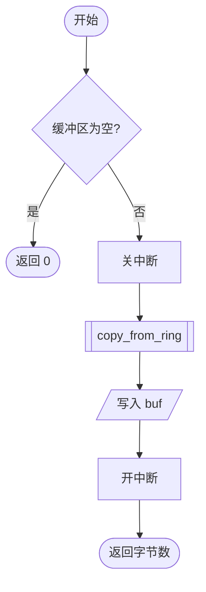
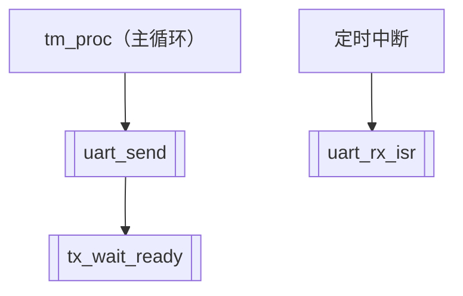

# 流程图写法

流程图用 Mermaid 写在 ```mermaid 代码块中。`mcp__docgen__render_docx` 生成 Word 时会把它转换成可编辑的 Word 图形（开始/结束、处理、判断等形状和带箭头的连线）；不支持的写法按代码块原样输出，并在结果的“注意”中说明，要改正后重新生成。

## 哪些函数要画

中断服务程序；含等待或超时循环的函数；状态机；有 3 个以上判断分支或嵌套循环的函数；含故障处理的函数。简单的读写、初始化函数可以不画。

## 支持的写法

只支持自上而下的流程图：



| 写法 | 形状 | 用途 |
|---|---|---|
| `S([开始])` | 圆角框 | 开始、结束、返回 |
| `B[关中断]` | 矩形 | 处理步骤 |
| `A{缓冲区为空?}` | 菱形 | 判断 |
| `D[/写入 buf/]` | 平行四边形 | 输入、输出（读写寄存器、端口） |
| `C[[copy_from_ring]]` | 双竖边矩形 | 调用本模块的其他函数 |
| `A --> B` | 连线 | |
| `A -- 是 --> B` 或 `A -->|是| B` | 带标注的连线 | 判断的出口 |
| `A --> B --> C` | 连写 | |
| `%% 注释` | | |

不支持：`subgraph`、`classDef`/`style`、`&` 连写、`LR` 等其他方向。

## 规则

1. 一个“开始”节点；每条路径都结束于“返回”或“结束”节点。
2. 判断节点至少两个出口，出口都标“是/否”（或具体取值）。
3. 框内文字不超过约 16 个字，长的写成“步骤 3.2：写 DATA”这样的简称，细节放在处理步骤中。
4. 节点与处理步骤一一对应，判断条件与处理步骤中的条件一致（包括 `>=` 还是 `>`）。
5. 循环用回到前面节点的连线表示，例如 `F --> C`。
6. 并列分支不超过 3 个，否则图会超出页宽，把一部分拆成子函数（用 `[[子函数名]]` 表示）单独画。
7. 图后面写图题，如“图 6-3 uart_send 流程图”，生成 Word 时会设为题注。

## 调用关系图

第 4.2 节的调用关系也可以用同样的语法画（所有节点用矩形或子程序形状，连线表示调用）。同一层的函数一字排开，函数多于 5～6 个时图会超出页宽，这时改用表格（调用者 | 被调用函数 | 执行环境），或按调用者拆成几张图：


