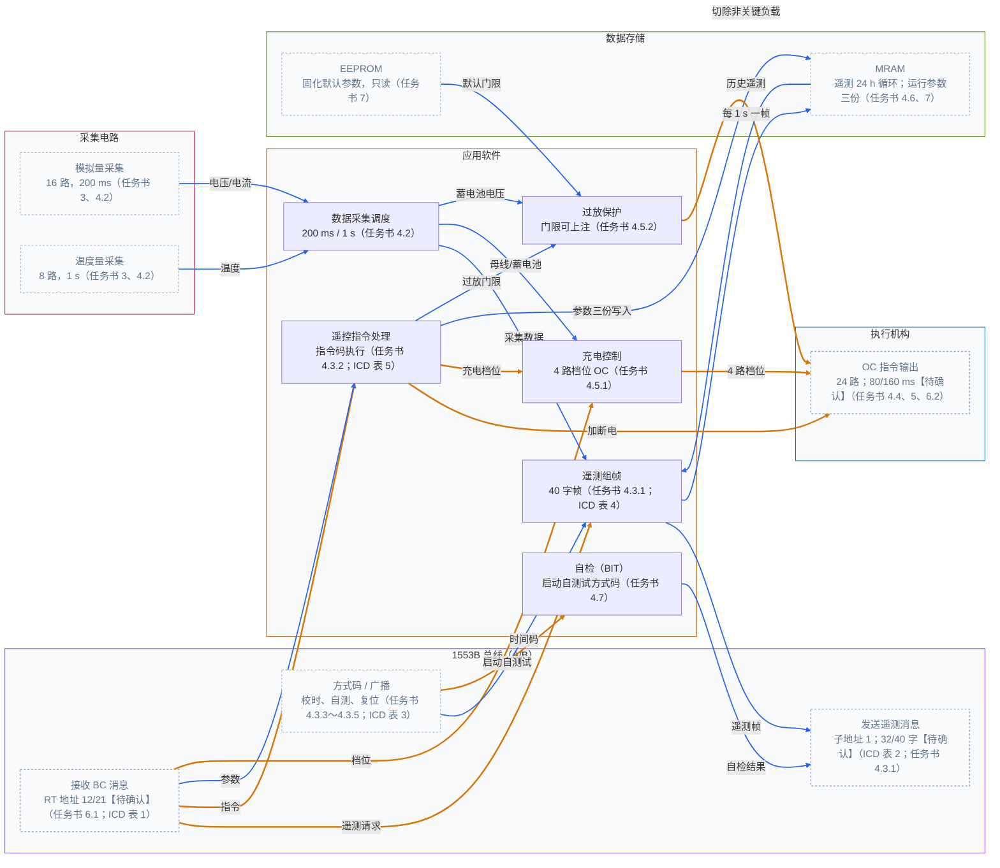

<!-- info-flow-diagram:generated 1.2.0 -->
# PCU 软件总体信息流（示例） · 分图：应用软件

> 依据：PCU 软件研制任务书 4.2～4.7、5、6.1、7；1553B ICD 表 1～5（虚构演示材料）
> 由模型 `PCU-信息流.flow.json` 生成（分图：应用软件）；要修改请改模型后重新出图，不要手改本文件和图片。

Mermaid 源码

## 统计

- 分组 5 个，节点 14 个，流向 22 条。
- 连线交叉 11 处；从别的节点框上经过的线 0 条；重叠的标签 0 个。
- 可读性：在一张图能看清的范围内。

## 待确认

- 接收 BC 消息：RT 地址 12/21【待确认】（任务书 6.1；ICD 表 1）
- 发送遥测消息：子地址 1；32/40 字【待确认】（ICD 表 2；任务书 4.3.1）
- OC 指令输出：24 路；80/160 ms【待确认】（任务书 4.4、5、6.2）
